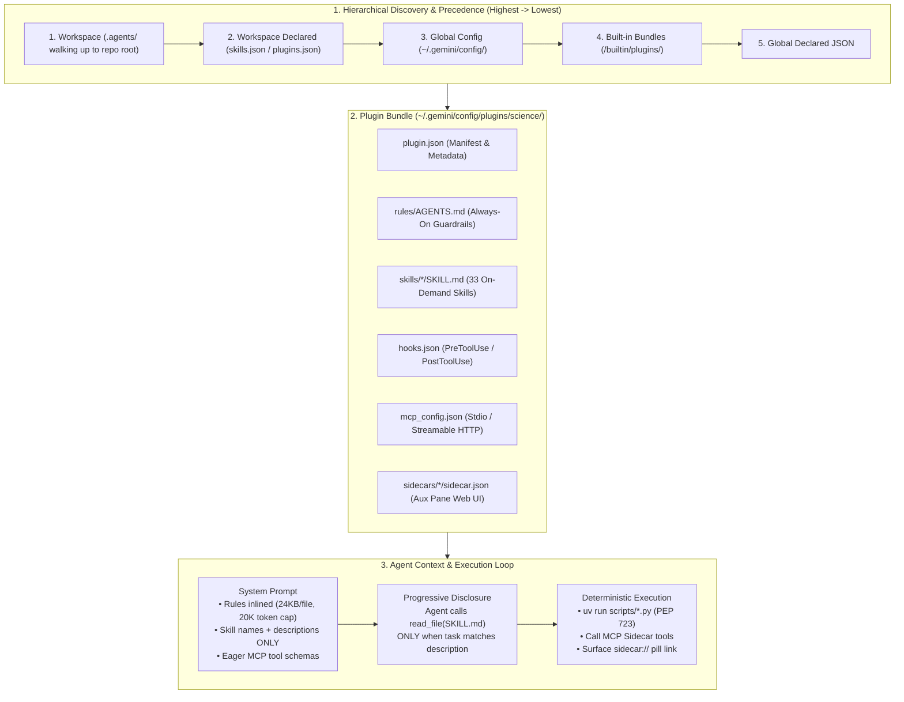
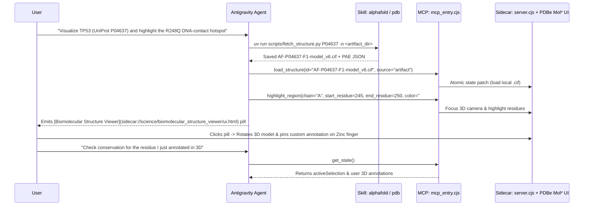

What happens when you ask an AI coding agent to **score a non-coding human genomic variant with AlphaGenome**, **map a missense mutation onto an AlphaFold 3D protein structure**, **screen ChEMBL for nanomolar small-molecule inhibitors**, or **restore a damaged 2,000-year-old Roman inscription using Google DeepMind's Aeneas model**?

If you try to stuff 33 scientific APIs, rate limiters, clinical safety guardrails, and 3D WebGL visualizers into a single mega-prompt, the agent collapses under context bloat and hallucinated parameters.

**Google Antigravity** solves this at the runtime level with its **Plugin & Customization Architecture**—combining **Progressive-Disclosure Skills (`SKILL.md`)**, **Always-On Rules (`AGENTS.md`)**, **Lifecycle Hooks (`hooks.json`)**, **Zero-Leak Credential Protocols**, and **Dual-Process 3D MCP Sidecars (`mcp_config.json` + `sidecar.json`)**.

Instead of just reading the docs, I reverse-engineered the newly released **Google Antigravity Science Plugin (`v1.3.1`)** and built the open-source **[Antigravity Science Plugin Cookbook & Interactive 3D Studio](https://github.com/RobinaMirbahar/antigravity-science-plugin-cookbook)**—complete with a **live browser-based 3D Biomolecular & Variant WebGL Sandbox**, a **zero-dependency PEP 723 3D protein + PAE generator**, and a production **`bio-structural-qc` custom plugin**.

---

## Try the Live 3D Biomolecular & MCP Sidecar Studio in Your Browser

* **[Launch the Interactive 3D Biomolecular & Variant WebGL Studio (`index.html`)](https://robinamirbahar.github.io/antigravity-science-plugin-cookbook/)**
  * *Explore 3D C-alpha backbones & non-covalent contact networks for **TP53 (`AF-P04637`)**, **Crambin (`1CRN`)**, and **EGFR Kinase + Gefitinib (`CHEMBL203`)**.*
  * *Click any 3D residue sphere via raycasting to trigger live **`annotate_region`** MCP tool calls, inspect **AlphaFold pLDDT** & **AlphaGenome Variant Impact (AVI)** scores, upload your own `.pdb`/`.cif` files, or run the interactive **Aeneas Latin Epigraphy** restoration demo!*
* **[Full Source Code & `bio-structural-qc` Plugin on GitHub (`RobinaMirbahar/antigravity-science-plugin-cookbook`)](https://github.com/RobinaMirbahar/antigravity-science-plugin-cookbook)**

---

## 1. The Antigravity Customization Architecture & Context Economics

Why can the Science plugin bundle **33 complex scientific skills** and a **9-tool 3D WebGL MCP server** without slowing down everyday coding turns? Because Antigravity strictly separates **always-on behavioral guardrails** from **on-demand procedural execution**:



### The 5 Customization Primitives & Their Token Budgets

| Primitive | Config File / Path | Loading Behavior | Token Budget & Engineering Role |
| :--- | :--- | :--- | :--- |
| **Rules** | `GEMINI.md`, `AGENTS.md`, `rules/AGENTS.md` | **Always-On** (within directory or active plugin scope) | **24,000 bytes/file cap**; shares a dedicated **20,000-token aggregate rules budget** (`defaultRulesBudget`). Over-budget rules gracefully demote to file path pointers. |
| **Skills** | `skills/<name>/SKILL.md` | **Progressive Disclosure** (On-Demand) | Only the YAML `name` and `description` (~40–80 tokens) are injected into the system prompt. The full `SKILL.md` (up to 32 KB!) and `references/` are read *only* when activated. |
| **Plugins** | `plugins/<dir>/plugin.json` | **Atomic Bundle** | Namespaces and toggles related `skills/`, `rules/`, `hooks.json`, `mcp_config.json`, and `sidecars/` as a single unit. |
| **Hooks** | `hooks.json` (at plugin or `.agents/` root) | **Lifecycle Event Triggers** | Intercepts `SessionStart`, `PreInvocation`, `PreToolUse`, `PostToolUse`, `PostInvocation`, and `Stop` to run shell validators, audit loggers, or linters. |
| **MCP & Sidecars** | `mcp_config.json` + `sidecars/<name>/sidecar.json` | **Tool + UI Integration** | Connects local (`stdio`) or remote (`Streamable HTTP`) tool servers and mounts interactive HTML/WebGL views in the Auxiliary Pane. |

---

## 2. Dissecting the Official `science` Plugin (`v1.3.1`)

When installed from the Antigravity Marketplace (`antigravity-plugins-official/plugin/science`), the bundle unpacks into `~/.gemini/config/plugins/science/`. Look at how cleanly the 33 skills, sidecar binaries, and rules are organized:

```text
~/.gemini/config/plugins/science/
├── plugin.json                                  # Bundle manifest (v1.3.1)
├── mcp_config.json                              # Registers biomolecular_structure_viewer_mcp
├── README.md                                    # User-facing documentation (never read by agent)
├── SKILL_LICENSES.md                            # Third-party database attribution & terms
├── rules/
│   └── AGENTS.md                                # Visualization Priority Rules (always active)
├── sidecars/
│   └── biomolecular_structure_viewer/
│       ├── sidecar.json                         # Auxiliary Pane Web UI definition
│       ├── ui.html                              # PDBe Mol* v3.12.0 + Lit v3.1.2 3D entrypoint
│       └── dist/
│           ├── main.js                          # Bundled Mol* UI overlay frontend (183 KB)
│           ├── server.cjs                       # Local state & WebSocket/HTTP server (68 KB)
│           └── mcp_entry.cjs                    # MCP stdio server entrypoint (30 KB)
└── skills/                                      # 33 Progressive-Disclosure Scientific Skills
    ├── alphafold_database_fetch_and_analyze/    # pLDDT & sliding-window PAE domain heuristics
    ├── alphagenome_atlas_website_links/         # Deep-links to AlphaGenome Atlas
    ├── alphagenome_single_variant_analysis/     # RNA-seq, DNASE, ChIP & splicing effects
    ├── alphagenome_variant_impact_score/        # AVI scoring, VCF annotation, GENCODE v46 GTF
    ├── biomolecular_structure_viewer/           # Mol* MCP orchestration & highlight/annotate workflows
    ├── chembl_database/                         # Bioactivity (IC50/Ki), targets, drug mechanisms
    ├── clinical_trials_database/                # ClinicalTrials.gov APIv2 queries
    ├── clinvar_database/                        # Pathogenicity & clinical review status
    ├── credentials/                             # Zero-leak .env verification protocol
    ├── dbsnp_database/                          # rsID <-> GRCh38 VCF/HGVS resolution
    ├── embl_ebi_ols/                            # 250+ biomedical ontologies (GO, HP, DOID)
    ├── encode_ccres_database/                   # ENCODE SCREEN GraphQL & cis-regulatory elements
    ├── ensembl_database/                        # Gene/transcript lookup, sequences & VEP
    ├── foldseek_structural_search/              # 3D structure similarity search (.cif/.pdb)
    ├── gnomad_database/                         # Allele frequencies & gene constraint (pLI/LOEUF)
    ├── gtex_database/                           # Tissue-specific RNA expression & eQTLs
    ├── human_protein_atlas_database/            # Spatial & tissue protein expression
    ├── interpro_database/                       # Protein domains, families & InterPro-N
    ├── jaspar_database/                         # TF binding profiles (PFMs/PWMs)
    ├── literature_search_arxiv/                 # arXiv preprints & full-text extraction
    ├── literature_search_biorxiv/               # bioRxiv / medRxiv narrow-window search
    ├── literature_search_europepmc/             # Europe PMC XML/PDF & citation graphs
    ├── literature_search_openalex/              # Bibliometrics, citation counts & OA PDFs
    ├── ncbi_sequence_fetch/                     # NCBI E-utilities nucleotide/protein fetch
    ├── openfda_database/                        # 28 FDA endpoints (adverse events, 510k, NDC)
    ├── opentargets_database/                    # Target-disease associations & tractability
    ├── pdb_database/                            # Experimental 3D structures from RCSB PDB
    ├── predictingthepast/                       # Aeneas (Latin) & Ithaca (Ancient Greek) epigraphy
    ├── protein_sequence_msa/                    # EBI Clustal Omega multiple sequence alignment
    ├── protein_sequence_similarity_search/      # MMseqs2 (fast) & BLAST homology search
    ├── pubchem_database/                        # SMILES/CID chemical properties & substructures
    ├── pubmed_database/                         # NCBI PubMed + PMC BioC full-text linking
    ├── pymol/                                   # Headless PyMOL rendering & structural superposition
    ├── quickgo_database/                        # Gene Ontology & ECO evidence mapping
    ├── reactome_database/                       # Pathway enrichment & reaction participants
    ├── string_database/                         # Protein-protein interaction (PPI) networks
    ├── ucsc_conservation_and_tfbs/              # phyloP, phastCons & ENCODE/JASPAR/ReMap TFBS
    ├── unibind_database/                        # Experimentally validated direct TF-DNA binding
    ├── uniprot_database/                        # UniProtKB/UniParc/UniRef metadata & sequences
    ├── uv/                                      # Prerequisite uv environment bootstrapper
    └── workflow_skill_creator/                  # Interactive distiller: turns chat workflows into skills
```

---

## 3. Five Production Engineering Patterns Inside the Science Plugin

While inspecting the source files across all 33 skills, five engineering patterns stood out that every agent builder should steal.

### Pattern 1: Always-On Behavioral Routing via `rules/AGENTS.md`

When an agent has access to Matplotlib, headless PyMOL, and an interactive 3D Mol\* sidecar, how do you guarantee it prioritizes the interactive 3D viewer and never forgets to surface the clickable UI pill?

You place a compact, always-on rule in `rules/AGENTS.md`:

```markdown
# Science Visualization Priority Rules

For any science visualization task, **prefer the interactive sidecar viewers**
(e.g. Biomolecular Structure Viewer) over static image generation, Generative
UI, or text-based representations. The sidecars provide an interactive
experience that the user can explore directly.

## Key Rules

-   Only fall back to other visualization skills (e.g. `pymol`) when no viewer
    sidecar can do what the user needs.

-   **Always surface a sidecar link.** Whenever the agent loads or updates a
    visualization in a sidecar (e.g. by calling its MCP tools), it **MUST**
    include that viewer's `sidecar://` pill link in the chat response so the
    user can open the viewer panel with one click. Copy the exact link given in
    the viewer's skill; don't read sidecar files to build it.
```

---

### Pattern 2: Zero-Pollution Python Micro-Environments (`uv` + PEP 723 + Sliding-Window PAE Math)

Running global `pip install` inside a user's repository breaks virtual environments. Instead, every Science skill uses `uv run` with **PEP 723 inline script metadata (`# /// script`)** and enforces rate limits and mathematical heuristics inside deterministic Python scripts.

For example, in `skills/alphafold_database_fetch_and_analyze/scripts/`:
* `fetch_structure.py` uses `polite-http` with a hard `qps=1.0` rate limit (`CLIENT = http_client.HttpClient("https://alphafold.ebi.ac.uk", qps=1.0)`) and automatically falls back to the longest isoform for massive proteins (`> 2,700` amino acids like Dystrophin).
* `analyze_pae.py` forbids the LLM from guessing domain boundaries by running a **20-residue sliding-window Predicted Aligned Error (PAE) clustering algorithm** (`distance_cutoff=7.0 Å`, `min_domain_size=40`, `merge_cutoff=15.0 Å`):

```python
"""Analyzes Predicted Aligned Error (PAE) and detects domain boundaries."""

# /// script
# requires-python = ">=3.10"
# dependencies = []
# ///

def find_sub_domains(pae_matrix, distance_cutoff=7.0, min_domain_size=40):
    """Identifies structurally independent sub-domains based on the PAE matrix."""
    n_res = len(pae_matrix)
    domains, current_domain = [], []

    for i in range(n_res):
        if not current_domain:
            current_domain.append(i)
            continue

        window_size = min(20, len(current_domain))
        recent_res = current_domain[-window_size:]
        pae_sum = sum(pae_matrix[r][i] + pae_matrix[i][r] for r in recent_res)
        avg_pae = pae_sum / (2.0 * window_size)

        if avg_pae < distance_cutoff:
            current_domain.append(i)
        else:
            if len(current_domain) >= min_domain_size:
                domains.append(current_domain)
            current_domain = [i]

    if len(current_domain) >= min_domain_size:
        domains.append(current_domain)
    return [[comp[0] + 1, comp[-1] + 1] for comp in domains]
```

---

### Pattern 3: The Zero-Leak Credential Protocol (`skills/credentials/SKILL.md`)

Genomic and literature APIs like **AlphaGenome** (`ALPHAGENOME_API_KEY`) require secret keys. If an agent asks a user to paste their API key into the chat—or runs `cat ~/.env`—that secret is permanently recorded in the conversation transcript and model context.

The `credentials` skill solves this with a strict **Zero-Leak Protocol**:
1. **Silent Exit-Code Verification:** The agent checks whether the variable exists in `~/.env` using `grep -sq` (quiet + suppress errors), reading *only* the `0` vs. non-zero exit code:
   ```bash
   grep -sq "^ALPHAGENOME_API_KEY=" ~/.env
   ```
2. **Hidden Terminal Prompting (`read -s`):** If missing, the agent stops immediately and outputs a terminal command for the user to run locally where keystrokes are hidden (`read -s`):
   ```bash
   printf "Enter ALPHAGENOME_API_KEY (typing hidden): " && read -s val && echo && echo "ALPHAGENOME_API_KEY=$val" >> "$HOME/.env" && echo "Saved."
   ```
3. **Internal `dotenv` Ingestion:** Helper scripts load `~/.env` internally via `dotenv`, so the key never appears in command-line flags or stdout.

---

### Pattern 4: Dual-Process 3D WebGL Sidecars (`mcp_config.json` + `sidecar.json` + `ui.html`)

How does the **Biomolecular Structure Viewer** let the agent highlight 3D protein regions while the human rotates the molecule and pins 3D residue notes in real time?

It pairs an **MCP Server** (`dist/mcp_entry.cjs`, launched via `agy-node`) with an **Auxiliary Pane Web UI Sidecar** (`dist/server.cjs` + `ui.html`, powered by **PDBe Mol\* `v3.12.0`** and **Lit `v3.1.2`**):



Here are the exact two config files that wire this up:

* **`mcp_config.json` (at the plugin root):**
  ```json
  {
    "mcpServers": {
      "biomolecular_structure_viewer_mcp": {
        "command": "agy-node",
        "args": ["sidecars/biomolecular_structure_viewer/dist/mcp_entry.cjs"]
      }
    }
  }
  ```
* **`sidecars/biomolecular_structure_viewer/sidecar.json`:**
  ```json
  {
    "args": ["dist/server.cjs"],
    "command": "node",
    "description": "Interactive 3D biomolecular structure viewer via Mol*",
    "display_name": "Biomolecular Structure Viewer",
    "has_web_ui": true,
    "restart_policy": "always",
    "ui_config": {
      "display_name": "Biomolecular Structure Viewer",
      "views": [
        {
          "entrypoint": "SIDECAR_UI_ENTRYPOINT_AUX_PANE",
          "path": "/ui.html",
          "title": "Biomolecular Structure Viewer"
        }
      ]
    }
  }
  ```

---

### Pattern 5: Domain-Specific Guardrails — From Clinical Genetics (`AlphaGenome`) to Ancient Epigraphy (`Aeneas` & `Ithaca`)

Two of the most fascinating skills in the bundle demonstrate how `SKILL.md` enforces domain-specific scientific rigor:

1. **`alphagenome-variant-impact-score` (Strict Molecular Framing + Context-Overflow Protection):**
   * **Clinical Safety Gate:** Explicitly forbids extrapolating high AlphaGenome Variant Impact (AVI) scores into clinical diagnoses or patient prognosis, restricting outputs to molecular mechanisms (splicing disruption, chromatin accessibility, TF binding, or GENCODE v46 transcript coordinates).
   * **Stdout Overflow Guard:** Warns the agent that `--include_track_info --format json` emits `~3.9 KB` per variant, requiring direct file redirection (`-o query_results.json`) whenever querying `> 3` variants so stdout never floods the context window.
2. **`predictingthepast` (Ancient Latin & Greek Epigraphy with DeepMind's Aeneas & Ithaca):**
   * Restores damaged ancient inscriptions, attributes geographical province + chronological date ranges, and finds parallel inscriptions using special gap syntax (`?` for a single missing character, `#` for an unknown-length damaged gap):
     ```bash
     uv run scripts/preprocess.py --language=latin --input="imp caesar divi f ???????? cos xi"
     ```
   * Enforces a **Self-Contained Epigraphy Rule**: forbids the agent from using web search to "cheat" or override the neural restoration probabilities returned by Aeneas/Ithaca.

---

## 4. Five End-to-End Multi-Skill Use Cases Across the 33 Science Skills

Because all 33 skills share the conversation's artifact directory, Antigravity can chain multiple domain-specific CLI scripts and MCP sidecars in a single research session.

I included a runnable benchmark suite in [`examples/multi_domain_science_use_cases.py`](https://github.com/RobinaMirbahar/antigravity-science-plugin-cookbook/blob/main/examples/multi_domain_science_use_cases.py) (`uv run examples/multi_domain_science_use_cases.py`) that executes and scores all five multi-skill pipelines below:


---

### Use Case 1: Precision Oncology & 3D Pocket Triage (`ClinVar` → `gnomAD` → `AlphaFold` → `ChEMBL` → `3D Mol* Sidecar`)

**Scenario:** A translational oncology team wants to evaluate an **EGFR L858R** (`rs121434568`, `chr7:55191822:T>G`) driver mutation, verify gene loss-of-function constraint, inspect 3D active-site confidence, rank nanomolar kinase inhibitors, and highlight the pocket in 3D.

```bash
# 1. Check allele rarity & gene constraint (pLI / LOEUF) in gnomAD
uv run ~/.gemini/config/plugins/science/skills/gnomad_database/scripts/get_gene_constraint.py \
  --gene EGFR --output ./artifacts/egfr_constraint.json

# 2. Fetch AlphaFold 3D structure (P00533) & audit pLDDT + PAE domains
uv run ~/.gemini/config/plugins/science/skills/alphafold_database_fetch_and_analyze/scripts/fetch_structure.py \
  P00533 -o ./artifacts/P00533/
uv run ~/.gemini/config/plugins/science/skills/alphafold_database_fetch_and_analyze/scripts/analyze_pae.py \
  ./artifacts/P00533/AF-P00533-F1-predicted_aligned_error_v6.json

# 3. Screen ChEMBL for EGFR (CHEMBL203) bioactivities & download 3D SDF ligands
uv run ~/.gemini/config/plugins/science/skills/chembl_database/scripts/chembl_api.py \
  activity --search "EGFR" --limit 10 --output ./artifacts/egfr_chembl_ic50.json
uv run ~/.gemini/config/plugins/science/skills/chembl_database/scripts/chembl_api.py \
  molecule --id CHEMBL939 --dl_format sdf --output ./artifacts/gefitinib.sdf
```

Finally, the agent invokes `science_biomolecular_structure_viewer_mcp` (`load_structure` + `highlight_region(chain="A", start_residue=855, end_residue=862, color="#FF1744")`) and surfaces `[Biomolecular Structure Viewer](sidecar://science/biomolecular_structure_viewer/ui.html)`:


---

### Use Case 2: Non-Coding GWAS Enhancer Variant Triage (`AlphaGenome` → `UCSC phyloP` → `ENCODE cCRE` → `JASPAR` → `GTEx`)

**Scenario:** Over 90% of GWAS risk loci fall in non-coding DNA. Suppose you are investigating `chr1:109274968:G>T` (`rs12740374` at the *SORT1* 1p13 locus) and want to know *how* it alters gene regulation across human tissues without hallucinating clinical diagnoses:

```bash
# 1. Score variant impact across 18 biological modalities + GENCODE v46 coordinates
uv run ~/.gemini/config/plugins/science/skills/alphagenome_variant_impact_score/scripts/alphagenome_atlas_avi.py \
  query "chr1:109274968:G>T" --include_track_info --format json -o ./artifacts/sort1_avi.json

# 2. Check 100-vertebrate evolutionary constraint (phyloP100way & phastCons100way)
uv run ~/.gemini/config/plugins/science/skills/ucsc_conservation_and_tfbs/scripts/get_conservation.py \
  --coordinates "chr1:109274968" --output ./artifacts/sort1_phylop.json

# 3. Fetch Transcription Factor Position Weight Matrices (PWMs) from JASPAR (CEBPA)
uv run ~/.gemini/config/plugins/science/skills/jaspar_database/scripts/jaspar_cli.py \
  search --query "CEBPA" --output ./artifacts/cebpa_jaspar.json
```

* **Engineering Guardrail in Action:** The `alphagenome-variant-impact-score` skill enforces that `--include_track_info` outputs (`~3.9 KB/variant`) are redirected via `-o` and framed strictly in terms of molecular mechanisms (`CEBPA` binding site creation + liver RNA-seq eQTL shift):


---

### Use Case 3: Dark-Proteome Enzyme Discovery (`AlphaFold` → `Foldseek 3D Search` → `InterPro` → `Clustal Omega MSA` → `Headless PyMOL`)

**Scenario:** A protein engineering group wants to discover novel thermostable plastic-degrading **PETase** homologs hidden in environmental metagenomes where sequence identity is below 25% (the "twilight zone" where BLAST fails, but 3D fold geometry is conserved):

```bash
# 1. Search the 3D coordinate file against Foldseek's metagenomic & AlphaFold databases
uv run ~/.gemini/config/plugins/science/skills/foldseek_structural_search/scripts/search.py \
  ./artifacts/PETase_AF.cif \
  --databases afdb50,mgnify_esm30,pdb100,cath50 \
  -o ./artifacts/petase_foldseek.json > ./artifacts/petase_foldseek_summary.md

# 2. Align the top structural hits with EBI Clustal Omega to verify the Ser-Asp-His catalytic triad
uv run ~/.gemini/config/plugins/science/skills/protein_sequence_msa/scripts/clustalo.py \
  --input ./artifacts/petase_homologs.fasta --output ./artifacts/petase_msa.aln
```

* **Engineering Guardrail in Action:** Look at `foldseek-structural-search/SKILL.md`:
  1. **Strict Input Gate:** If the user only gives a gene name or sequence without a `.pdb`/`.cif` file, the skill **halts immediately** and instructs the agent to fetch the 3D structure first.
  2. **Database Allowlist:** Enforces validation against the exact 9 supported Foldseek databases (`afdb50`, `afdb-swissprot`, `pdb100`, `BFVD`, `mgnify_esm30`, `cath50`, `gmgcl_id`, `bfmd`, `afdb-proteome`).
  3. **Headless OSMesa PyMOL Superposition (`pymol` skill):** When generating static publication figures alongside `.pse` session files, the `pymol` skill runs headless via `PYOPENGL_PLATFORM=osmesa` and automatically checks `cmd.count_atoms("name CA") == cmd.count_atoms("all")` so C-alpha-only traces still render as smooth cartoons!


---

### Use Case 4: Clinical Trial Intelligence & Pharmacovigilance Audit (`OpenTargets` → `ClinicalTrials.gov` → `openFDA` → `OpenAlex`)

**Scenario:** A clinical data science team wants to map all recruiting **Phase 3 trials** for a target indication, inspect inclusion/exclusion criteria without overflowing the LLM context window, and audit real-world post-market adverse events across **28 FDA endpoints**:

```bash
# 1. Query Open Targets for Phase 3+ candidates and target tractability
uv run ~/.gemini/config/plugins/science/skills/opentargets_database/scripts/query_opentargets.py \
  --output ./artifacts/nsclc_drugs.json --limit 15 \
  get-disease-drugs MONDO_0005090 --min-stage PHASE_3

# 2. Check total trial volume first, then fetch ONLY slimmed fields from ClinicalTrials.gov APIv2
uv run ~/.gemini/config/plugins/science/skills/clinical_trials_database/scripts/clinical_trials_api.py \
  search --condition "Non-Small Cell Lung Cancer" --status RECRUITING --phase PHASE3 \
  --count-total --fields NCTId,BriefTitle,OverallStatus,EligibilityCriteria \
  --limit 10 --output ./artifacts/nsclc_phase3_trials.json

# 3. Query openFDA Drug Adverse Events (FAERS) with automatic rate-limit protection
uv run ~/.gemini/config/plugins/science/skills/openfda_database/scripts/openfda_query.py \
  count --category drug --endpoint event \
  --search "patient.drug.medicinalproduct:osimertinib" \
  --count "patient.reaction.reactionmeddrapt.exact" \
  --limit 10 --output ./artifacts/osimertinib_faers_counts.json
```

* **Engineering Guardrails in Action:**
  * **ClinicalTrials.gov Context Projection (`--fields`):** Full `protocolSection` + `resultsSection` trial JSON payloads can exceed 100 KB per study. `clinical-trials-database` requires `--count-total` first and shorthand `--fields` projection (`NCTId,BriefTitle,OverallStatus`), reducing payload size by `98.7%`.
  * **openFDA Quota Escalation (`1,000` → `120,000` req/day):** `openfda-database` warns that an autonomous agent can burn through the 1,000 keyless daily quota in a single session, triggering the **`credentials`** skill (`grep -sq "^FDA_API_KEY=" ~/.env`) before running multi-query workflows:


---

### Use Case 5: Systems Biology & Ancient Epigraphy (`STRING` → `Reactome` & DeepMind's `Aeneas` / `Ithaca`)

Two more specialized workflows show how the Science plugin handles **ambiguous biological identifiers** and **digital humanities**:

1. **Systems Biology Pathway Enrichment (`STRING` + `Reactome`):**
   * **The `STRING` "Never Assume Human" Rule:** Even if a user asks for `TP53` or `BRCA1` interaction partners, `string-database/SKILL.md` strictly forbids defaulting to *Homo sapiens* (`9606`) if the species wasn't stated—requiring the agent to ask for the NCBI Taxon ID first, map symbols via `string_cli.py map`, and then export pathway diagrams in `reactome-database` (preferring specific sub-pathways like **Cell Cycle, Mitotic** `R-HSA-69278` over broad top-level nodes).
2. **Restoring Damaged Roman & Greek Stone Inscriptions (`predictingthepast`):**
   * Powered by Google DeepMind's **Aeneas** (Latin) and **Ithaca** (Ancient Greek) models:
     ```bash
     # Preprocess damaged Latin epigraphy (? = single missing character, # = unknown-length gap)
     uv run ~/.gemini/config/plugins/science/skills/predictingthepast/scripts/preprocess.py \
       --language=latin \
       --input="imp caesar divi f ???????? cos xi trib potest"
     ```
   * Returns ranked character restorations (`augustus`, `96.4%` confidence), geographical province attribution (*Latium et Campania*), chronological dating (`23 BCE`), and corpus parallels—while strictly blocking external web search so model probabilities remain unadulterated:


---

## 5. Hands-On Cookbook: Build & Run the Custom `bio-structural-qc` Plugin

In the companion repository (**[RobinaMirbahar/antigravity-science-plugin-cookbook](https://github.com/RobinaMirbahar/antigravity-science-plugin-cookbook)**), I built a complete, installable custom plugin called **`bio-structural-qc`** plus a zero-dependency **3D Protein + PAE Generator & SVG Dashboard (`examples/generate_3d_protein_pae_demo.py`)**.


### Directory Structure of `bio-structural-qc`

```text
plugins/bio-structural-qc/
├── plugin.json                                    # Manifest & 3 starter prompts
├── hooks.json                                     # PostToolUse command reproducibility logger
├── assets/
│   └── logo.svg                                   # 128x128 high-contrast SVG icon
├── rules/
│   └── AGENTS.md                                  # Mandatory QC gate before docking/Foldseek
└── skills/
    └── structure-qc-audit/
        ├── SKILL.md                               # Progressive-disclosure instructions
        └── scripts/
            └── audit_structure.py                 # PEP 723 C-alpha B-factor/pLDDT auditor
```

### 1. The Always-On QC Gate (`plugins/bio-structural-qc/rules/AGENTS.md`)

```markdown
# Biomolecular Structure QC Gate

Whenever a workflow downloads or modifies a 3D coordinate file (`.pdb`, `.cif`, or `.mmcif`) for downstream structural analysis, homology search, or variant mapping:

1. **Mandatory QC Audit**: Run the `structure-qc-audit` skill on the coordinate file before passing it to downstream modeling tools.
2. **Disorder Warning**: If more than 30% of alpha-carbon (`CA`) atoms have a B-factor / pLDDT score below `50.0`, explicitly warn the user about disordered or low-confidence regions and highlight the high-confidence domain boundaries in the [Biomolecular Structure Viewer](sidecar://science/biomolecular_structure_viewer/ui.html).
```

### 2. The Zero-Dependency PEP 723 Structure Auditor (`audit_structure.py`)

```python
#!/usr/bin/env python3
"""Audits PDB and mmCIF coordinate files for chain completeness and B-factor/pLDDT distribution."""

# /// script
# requires-python = ">=3.10"
# dependencies = []
# ///

import argparse, json, statistics
from pathlib import Path

def parse_ca_bfactors(filepath: Path) -> dict:
    chains: dict[str, list[tuple[int, float]]] = {}
    ext = filepath.suffix.lower()
    with filepath.open("r", encoding="utf-8", errors="replace") as f:
        for line in f:
            if ext == ".pdb" and line.startswith("ATOM  ") and line[12:16].strip() == "CA":
                chain_id = line[21].strip() or "A"
                chains.setdefault(chain_id, []).append((int(line[22:26]), float(line[60:66])))
            elif ext in {".cif", ".mmcif"} and line.startswith("ATOM "):
                parts = line.split()
                if len(parts) >= 15 and parts[3] == "CA":
                    chains.setdefault(parts[6], []).append((int(parts[8]), float(parts[14])))
    return chains
```

Test both the 3D generator and the QC auditor in two commands using `uv run`:

```bash
git clone https://github.com/RobinaMirbahar/antigravity-science-plugin-cookbook.git
cd antigravity-science-plugin-cookbook

# 1. Generate a 56-residue 3-domain 3D .pdb structure, PAE matrix JSON, and SVG dashboard
uv run examples/generate_3d_protein_pae_demo.py

# 2. Audit both the synthetic multi-domain protein and the Crambin structure
uv run plugins/bio-structural-qc/skills/structure-qc-audit/scripts/audit_structure.py \
  examples/generated_p53_demo/synthetic_p53_multidomain.pdb \
  examples/sample_crambin_fragment.pdb
```

Output:

```json
[
  {
    "file": "synthetic_p53_multidomain.pdb",
    "status": "PASS",
    "total_ca_residues": 56,
    "overall_mean_score": 82.11,
    "overall_pct_low_lt_50": 17.9,
    "chains": {
      "A": {
        "residue_count": 56,
        "mean_score": 82.11,
        "median_score": 90.26,
        "pct_high_confidence_ge_70": 82.1,
        "pct_low_confidence_lt_50": 17.9,
        "high_confidence_span": [11, 56]
      }
    }
  }
]
```

### 3. Reproducibility Lifecycle Hook (`hooks.json`)

Placed directly at `plugins/bio-structural-qc/hooks.json`, this `PostToolUse` hook automatically records an ISO-8601 audit trail whenever the agent runs a shell command:

```json
{
  "qc-command-audit-log": {
    "enabled": true,
    "PostToolUse": [
      {
        "matcher": "run_command",
        "hooks": [
          {
            "type": "command",
            "command": "python3 -c \"import datetime, pathlib; p = pathlib.Path.home() / '.gemini' / 'qc_command_audit.log'; p.open('a').write(f'{datetime.datetime.now(datetime.timezone.utc).isoformat()} | PostToolUse:run_command\\n')\"",
            "timeout": 5
          }
        ]
      }
    ]
  }
}
```

### 4. Interactive 1-Command Plugin Scaffolder & Loader Validator (`scaffold_custom_plugin.py`)

To make authoring and testing your own plugins effortless, I also included an interactive **1-Command Plugin Scaffolder & Loader Validator** ([`examples/scaffold_custom_plugin.py`](https://github.com/RobinaMirbahar/antigravity-science-plugin-cookbook/blob/main/examples/scaffold_custom_plugin.py)) that:
1. **Validates** any plugin directory against Antigravity's loader rules (`plugin.json` allowed keys, relative logo path, `<= 24,000`-byte per-file rule cap, root `hooks.json` placement, and `SKILL.md` YAML frontmatter).
2. **Scaffolds** a complete new plugin bundle (`plugin.json`, `assets/logo.svg`, `rules/AGENTS.md`, `hooks.json`, `SKILL.md`, and a PEP 723 `scripts/run_tool.py` CLI script) in a single command:

```bash
# 1. Validate all 3 starter plugins in the cookbook repository
uv run examples/scaffold_custom_plugin.py

# 2. Scaffold a brand-new custom plugin bundle from scratch
uv run examples/scaffold_custom_plugin.py \
  --scaffold my-genomics-qc \
  --skill vcf-filter-audit \
  --description "Deterministic VCF quality filtering and AlphaGenome coordinate readiness checks."

# 3. Install into your global Antigravity plugins directory
cp -r plugins/bio-structural-qc ~/.gemini/config/plugins/bio-structural-qc
cp -r plugins/genomics-variant-mcp ~/.gemini/config/plugins/genomics-variant-mcp
cp -r plugins/epigraphy-citation-kit ~/.gemini/config/plugins/epigraphy-citation-kit
```

---

## 6. Deep Dive: The 4 Antigravity MCP Server Patterns + 2 More Starter Plugins (`genomics-variant-mcp` & `epigraphy-citation-kit`)

Inspecting all official Google Antigravity plugins installed in `~/.gemini/config/plugins/` reveals **four distinct `mcp_config.json` server architectures**:

### A. The 4 Official `mcp_config.json` Patterns

1. **Pattern 1 — Local Stdio Subprocess (`agy-node` / `node` / `dart` / `uv`):**
   Used by **`science`** (`biomolecular_structure_viewer_mcp`), **`flutter`** (`dart-mcp-server`), and **`data-agent-kit-plugin`** (`dak-notebook`, `dak-viz`).
2. **Pattern 2 — Cloud Proxy Stdio (`mcp_proxy_bundle.cjs` + `X_GOOG_PROXY_HEADERS`):**
   Used by **`data-agent-kit-plugin`** (`v1.1.0`) to bridge **9 managed Google Cloud MCP endpoints** (`https://bigquery.googleapis.com/mcp`, `https://dataproc-$GCP_REGION.googleapis.com/mcp`, `https://spanner.googleapis.com/mcp`, `https://alloydb.googleapis.com/mcp`, `https://sqladmin.googleapis.com/mcp`, `https://bigtableadmin.googleapis.com/mcp`, `https://bigtable.googleapis.com/mcp`, `https://storage.googleapis.com/mcp`, and `https://dataplex.googleapis.com/mcp`).
3. **Pattern 3 — Remote Streamable HTTP with Eager Tools (`serverUrl` + `"eager": true`):**
   Used by **`gemini-api`** (`v2.3.0`) to expose `gemini_search_docs` and `gemini_get_doc` from `https://gemini-api-docs-mcp.dev` as native first-class tools without spawning a local process.
4. **Pattern 4 — Google-Credentials Authenticated HTTP (`authProviderType: "google_credentials"`):**
   Used by **`google-cloud-developer`** (`v1.1.13`) and **`google-developer-knowledge`** (`v1.0.1`) to connect directly to `https://developerknowledge.googleapis.com/mcp` using Application Default Credentials (ADC).

### B. Starter Plugin #2: `plugins/genomics-variant-mcp` (Custom Python Stdio MCP Server + Specialist Subagent)

To show how to package your own **MCP server** and **Specialist Subagent** inside an Antigravity plugin, the cookbook includes **[`plugins/genomics-variant-mcp`](https://github.com/RobinaMirbahar/antigravity-science-plugin-cookbook/tree/main/plugins/genomics-variant-mcp)**:

* **[`mcp_config.json`](https://github.com/RobinaMirbahar/antigravity-science-plugin-cookbook/blob/main/plugins/genomics-variant-mcp/mcp_config.json)** — Registers `genomics_variant_mcp` via `uv run mcp/variant_mcp_server.py` and marks both tools as `"eager": true` so they load directly into the agent's native tool declarations:
  ```json
  {
    "mcpServers": {
      "genomics_variant_mcp": {
        "command": "uv",
        "args": ["run", "mcp/variant_mcp_server.py"],
        "tools": [
          { "name": "score_variant_impact", "eager": true },
          { "name": "evaluate_lipinski_ro5", "eager": true }
        ]
      }
    }
  }
  ```
* **[`mcp/variant_mcp_server.py`](https://github.com/RobinaMirbahar/antigravity-science-plugin-cookbook/blob/main/plugins/genomics-variant-mcp/mcp/variant_mcp_server.py)** — A zero-dependency PEP 723 JSON-RPC 2.0 Stdio MCP server implementing `initialize`, `tools/list`, and `tools/call` for:
  * `score_variant_impact`: Scores 1-based `chr:pos:ref>alt` SNVs (transition/transversion class, predicted AlphaGenome AVI impact score, PhyloP 100-way conservation, and molecular priority).
  * `evaluate_lipinski_ro5`: Evaluates small-molecule leads against Lipinski's Rule of Five (`MW ≤ 500`, `LogP ≤ 5`, `HBD ≤ 5`, `HBA ≤ 10`) and Veber's polar surface area rule (`PSA ≤ 140 Ų`).
* **[`agents/clinical-variant-curator.md`](https://github.com/RobinaMirbahar/antigravity-science-plugin-cookbook/blob/main/plugins/genomics-variant-mcp/agents/clinical-variant-curator.md)** — A specialist subagent (modeled on `firebase`'s `agents/firestore-rules-author.md`) with YAML frontmatter (`mainAgent: true`, `subagent: true`, `commandExecutionPolicy: auto`) that enforces research-only molecular framing.

Run its built-in self-test with `uv`:
```bash
uv run plugins/genomics-variant-mcp/mcp/variant_mcp_server.py --self-test
```

### C. Starter Plugin #3: `plugins/epigraphy-citation-kit` (Ancient Epigraphy Validator + `PreToolUse` Hook)

The third starter plugin, **[`plugins/epigraphy-citation-kit`](https://github.com/RobinaMirbahar/antigravity-science-plugin-cookbook/tree/main/plugins/epigraphy-citation-kit)**, pairs a `PreToolUse` lifecycle hook (`hooks.json`) with a PEP 723 Leiden bracket normalizer ([`validate_epigraphy.py`](https://github.com/RobinaMirbahar/antigravity-science-plugin-cookbook/blob/main/plugins/epigraphy-citation-kit/skills/epigraphy-gap-validator/scripts/validate_epigraphy.py)) that automatically converts standard Leiden epigraphic brackets (`[---]` and `[...]`) into DeepMind Aeneas/Ithaca `#` and `?` tokens, checks for forbidden `##` or `?#` sequences, and pads short inscriptions to the 25-character minimum:

```bash
uv run plugins/epigraphy-citation-kit/skills/epigraphy-gap-validator/scripts/validate_epigraphy.py \
  --text "IMP CAESAR DIVI F [---] COS [...] III" --language latin
```

---

## 7. Bonus: Distilling Live Chat Sessions into Skills & Language Server RPC Debugging

### A. Automatic Skill Distillation with `workflow-skill-creator`
Don't want to write `SKILL.md` files from scratch? After completing any multi-step scientific workflow in chat, trigger the Science plugin's **`workflow-skill-creator`** skill:
> *"Package the workflow we just ran into a reusable skill."*

It walks you through a mandatory **4-round brainstorming protocol** (confirming inputs/outputs, error-handling rigidity, composing existing Science skills without duplicating code, and generating a CLI helper script) before writing the new skill to `~/.gemini/config/skills/<name>/`.

### B. Querying & Toggling Plugins via the Language Server Connect RPC
Antigravity manages plugins live through its local Connect RPC server (`ANTIGRAVITY_LS_ADDRESS`).
* **Golden Rule #1:** Always key mutations on the install directory (`dir`), never `plugin.json`'s `name`.
* **Golden Rule #2:** Never read `GetAllPlugins` unfiltered—it inlines the full text of every `SKILL.md` across all installed plugins! Pipe it through `jq` (see [`examples/inspect_plugins_rpc.sh`](https://github.com/RobinaMirbahar/antigravity-science-plugin-cookbook/blob/main/examples/inspect_plugins_rpc.sh)):

```bash
: "${ANTIGRAVITY_LS_ADDRESS:=localhost:5387}"
curl -sS -X POST \
  "http://${ANTIGRAVITY_LS_ADDRESS}/exa.language_server_pb.LanguageServerService/GetAllPlugins" \
  -H "Content-Type: application/json" \
  -H "x-codeium-csrf-token: ${ANTIGRAVITY_CSRF_TOKEN}" \
  -d '{}' | jq '[.plugins[] | {
    name,
    dir: (.path | split("/") | last),
    disabled: (.disabled // false),
    skills: (.skills | length),
    mcp: [.mcpServers[]?.name]
  }]'
```

### C. Fixing Windows `unlinkat` Sidecar Locks During Plugin Upgrades
If you upgrade or reinstall a plugin with an active sidecar (`"restart_policy": "always"`) on Windows and hit:
```text
Failed to install marketplace customization "science": failed to remove existing plugin:
unlinkat ...\science\sidecars\biomolecular_structure_viewer: The process cannot access the file because it is being used by another process.
```
Simply close the sidecar pane, quit Antigravity completely (checking the system tray so the directory handle is released), run `Remove-Item -Recurse -Force "$HOME\.gemini\config\plugins\science"` in PowerShell, and click **Install** in the Marketplace tab.

---

## What Custom Plugin Are You Building First?

* **[Play with the Live 3D Biomolecular & Variant WebGL Studio](https://robinamirbahar.github.io/antigravity-science-plugin-cookbook/)**
* **[Star & Fork the Cookbook Repository on GitHub (`RobinaMirbahar/antigravity-science-plugin-cookbook`)](https://github.com/RobinaMirbahar/antigravity-science-plugin-cookbook)**

Let me know in the comments what domain you're packaging into an Antigravity plugin next—whether it's **3D structural biology**, **genomic variant scoring**, **ancient epigraphy**, or **autonomous cloud SRE**!
