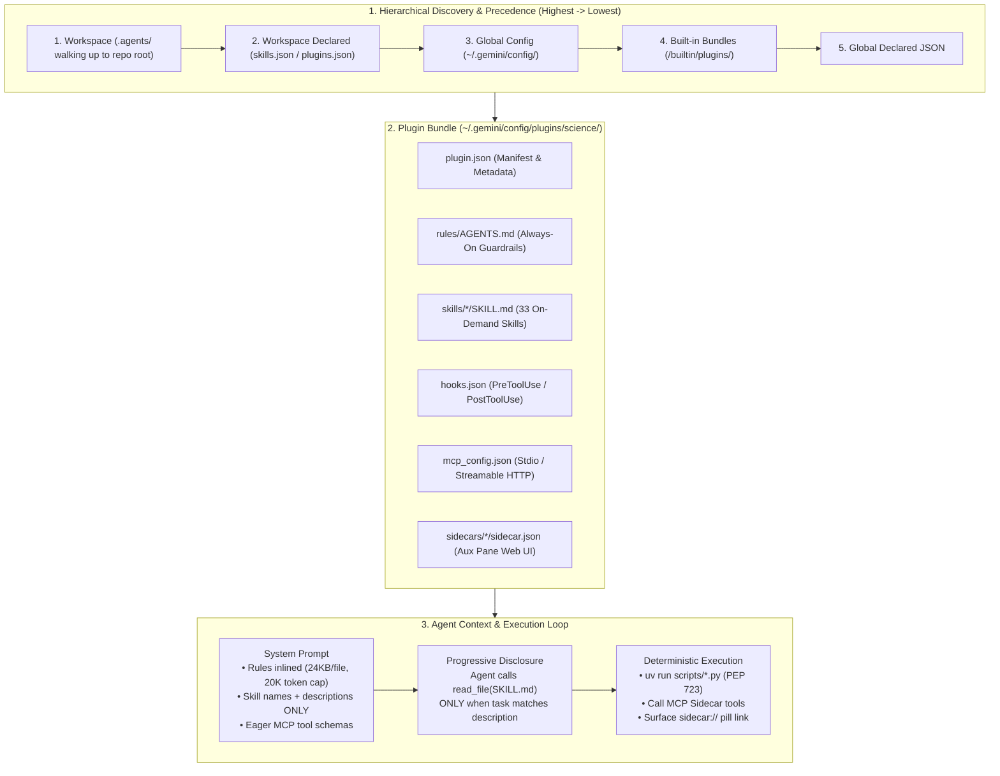
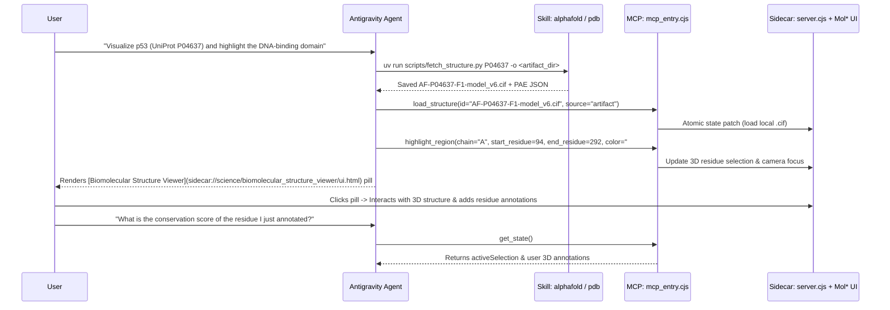

When scaling an autonomous coding or research agent from a general-purpose assistant into a domain-specific expert, **dumping 50 pages of API documentation into a single system prompt fails quickly**. It bloats the context window, introduces instruction drift, and offers no deterministic guarantees for rate limiting, credential security, or interactive visualization.

**Google Antigravity** solves this at the systems level through its **Customization & Plugin Architecture**—a composable hierarchy of **Progressive-Disclosure Skills (`SKILL.md`)**, **Always-On Rules (`AGENTS.md`)**, **Lifecycle Hooks (`hooks.json`)**, **Model Context Protocol (MCP) Servers (`mcp_config.json`)**, and **Interactive Auxiliary Pane Sidecars (`sidecar.json`)**.

Instead of speaking in abstract theory, in this engineering deep dive and cookbook we will reverse-engineer one of the most sophisticated official bundles in the ecosystem—the **Google Antigravity Science Plugin (`v1.3.1`)**—and use its exact architectural patterns to build, package, and debug your own custom Antigravity plugins from scratch.

### What We Will Cover in This Cookbook

1. **The 5 Pillars of Antigravity Customizations:** How Rules, Skills, Plugins, Lifecycle Hooks, and MCP Sidecars fit together—plus the 5-tier **Discovery & Precedence Hierarchy** and **20,000-Token Rules Budget**.
2. **Inside the Official `science` Plugin (`v1.3.1`):** Dissecting a production bundle containing **33 specialized scientific skills** (AlphaFold, AlphaGenome, ChEMBL, PDB, ClinVar, gnomAD, Reactome, Aeneas/Ithaca), an always-on visualization rule, and an interactive **3D Mol\* Biomolecular Structure Viewer**.
3. **Pattern #1 — Self-Contained `uv` + PEP 723 Micro-Scripts:** How to give skills deterministic CLI superpowers with inline dependency declarations (`# /// script`) and built-in QPS rate-limiting—zero `pip install` pollution required.
4. **Pattern #2 — The Zero-Leak Credential Protocol:** How the `credentials` skill verifies API keys (`ALPHAGENOME_API_KEY`) using silent exit codes (`grep -sq`) and hidden terminal prompts (`read -s`) so secrets never enter the LLM context window or chat transcript.
5. **Pattern #3 — Dual-Process MCP + WebGL UI Sidecars:** How `mcp_config.json` and `sidecar.json` work together to bridge atomic MCP tool calls (`load_structure`, `highlight_region`) with a live 3D Mol\* canvas via `sidecar://` pills.
6. **Build Your Own Plugin From Scratch:** Complete, copy-pasteable code for a custom **`bio-structural-qc`** plugin—including `plugin.json`, `rules/AGENTS.md`, `hooks.json` (`PreToolUse` / `PostToolUse`), a PEP 723 Python structure-auditor skill, and Language Server RPC commands (`GetAllPlugins`, `JetboxWriteState`).

---

## 1. The Antigravity Customization Architecture & Context Economics

To understand why Antigravity plugins scale to dozens of specialized tools without degrading reasoning accuracy, look at how the runtime separates **always-on constraints** from **on-demand procedural knowledge**:



### The 5 Customization Primitives

| Primitive | Config File / Path | Loading Behavior | Token Budget & Engineering Role |
| :--- | :--- | :--- | :--- |
| **Rules** | `GEMINI.md`, `AGENTS.md`, `rules/AGENTS.md` | **Always-On** (within directory or active plugin scope) | **24,000 bytes/file cap**; shares a dedicated **20,000-token aggregate rules budget** (`defaultRulesBudget`). Over-budget rules gracefully demote to file path pointers. |
| **Skills** | `skills/<name>/SKILL.md` | **Progressive Disclosure** (On-Demand) | Only the YAML `name` and `description` (~40–80 tokens) are injected into the system prompt. The full `SKILL.md` and `references/` are read *only* when activated. |
| **Plugins** | `plugins/<dir>/plugin.json` | **Atomic Bundle** | Namespaces and toggles related `skills/`, `rules/`, `hooks.json`, `mcp_config.json`, and `sidecars/` as a single unit. |
| **Hooks** | `hooks.json` (at plugin or `.agents/` root) | **Lifecycle Event Triggers** | Intercepts `SessionStart`, `PreInvocation`, `PreToolUse`, `PostToolUse`, `PostInvocation`, and `Stop` to run shell validators or linters. |
| **MCP & Sidecars** | `mcp_config.json` + `sidecars/<name>/sidecar.json` | **Tool + UI Integration** | Connects local (`stdio`) or remote (`Streamable HTTP`) tool servers and mounts interactive HTML/WebGL views in the Auxiliary Pane. |

---

## 2. Dissecting the Official `science` Plugin (`v1.3.1`)

When you install the official **Science** plugin from the Antigravity Marketplace (`antigravity-plugins-official/plugin/science`), it lands in `~/.gemini/config/plugins/science/`. Let's inspect its exact directory layout:

```text
~/.gemini/config/plugins/science/
├── plugin.json                                  # Bundle manifest (v1.3.1)
├── mcp_config.json                              # Registers biomolecular_structure_viewer_mcp
├── README.md                                    # User-facing documentation (ignored by agent)
├── SKILL_LICENSES.md                            # Third-party database attribution & terms
├── rules/
│   └── AGENTS.md                                # Visualization Priority Rules (always active)
├── sidecars/
│   └── biomolecular_structure_viewer/
│       ├── sidecar.json                         # Auxiliary Pane Web UI definition
│       ├── ui.html                              # Mol* 3D canvas entrypoint
│       └── dist/
│           ├── main.js                          # Bundled Mol* frontend (183 KB)
│           ├── server.cjs                       # Local state & WebSocket/HTTP server (68 KB)
│           └── mcp_entry.cjs                    # MCP stdio server entrypoint (30 KB)
└── skills/                                      # 33 Progressive-Disclosure Scientific Skills
    ├── alphafold_database_fetch_and_analyze/    # pLDDT & PAE domain boundary heuristics
    ├── alphagenome_atlas_website_links/         # Deep-links to AlphaGenome Atlas
    ├── alphagenome_single_variant_analysis/     # RNA-seq, DNASE, ChIP & splicing effects
    ├── alphagenome_variant_impact_score/        # AVI scoring, VCF annotation, GENCODE v46 GTF
    ├── biomolecular_structure_viewer/           # Mol* MCP orchestration & highlight/annotate workflows
    ├── chembl_database/                         # Bioactivity (IC50/Ki), targets, drug mechanisms
    ├── clinical_trials_database/                # ClinicalTrials.gov APIv2 queries
    ├── clinvar_database/                        # Pathogenicity & clinical review status
    ├── credentials/                             # Zero-leak .env verification protocol
    ├── dbsnp_database/                          # rsID <-> GRCh38 VCF/HGVS resolution
    ├── embl_ebi_ols/                            # 250+ biomedical ontologies (GO, HP, DOID)
    ├── encode_ccres_database/                   # ENCODE SCREEN GraphQL & cis-regulatory elements
    ├── ensembl_database/                        # Gene/transcript lookup, sequences & VEP
    ├── foldseek_structural_search/              # 3D structure similarity search (.cif/.pdb)
    ├── gnomad_database/                         # Allele frequencies & gene constraint (pLI/LOEUF)
    ├── gtex_database/                           # Tissue-specific RNA expression & eQTLs
    ├── human_protein_atlas_database/            # Spatial & tissue protein expression
    ├── interpro_database/                       # Protein domains, families & InterPro-N
    ├── jaspar_database/                         # TF binding profiles (PFMs/PWMs)
    ├── literature_search_arxiv/                 # arXiv preprints & full-text extraction
    ├── literature_search_biorxiv/               # bioRxiv / medRxiv narrow-window search
    ├── literature_search_europepmc/             # Europe PMC XML/PDF & citation graphs
    ├── literature_search_openalex/              # Bibliometrics, citation counts & OA PDFs
    ├── ncbi_sequence_fetch/                     # NCBI E-utilities nucleotide/protein fetch
    ├── openfda_database/                        # 28 FDA endpoints (adverse events, 510k, NDC)
    ├── opentargets_database/                    # Target-disease associations & tractability
    ├── pdb_database/                            # Experimental 3D structures from RCSB PDB
    ├── predictingthepast/                       # Aeneas (Latin) & Ithaca (Ancient Greek) epigraphy
    ├── protein_sequence_msa/                    # EBI Clustal Omega multiple sequence alignment
    ├── protein_sequence_similarity_search/      # MMseqs2 (fast) & BLAST homology search
    ├── pubchem_database/                        # SMILES/CID chemical properties & substructures
    ├── pubmed_database/                         # NCBI PubMed + PMC BioC full-text linking
    ├── pymol/                                   # Headless PyMOL rendering & structural superposition
    ├── quickgo_database/                        # Gene Ontology & ECO evidence mapping
    ├── reactome_database/                       # Pathway enrichment & reaction participants
    ├── string_database/                         # Protein-protein interaction (PPI) networks
    ├── ucsc_conservation_and_tfbs/              # phyloP, phastCons & ENCODE/JASPAR/ReMap TFBS
    ├── unibind_database/                        # Experimentally validated direct TF-DNA binding
    ├── uniprot_database/                        # UniProtKB/UniParc/UniRef metadata & sequences
    ├── uv/                                      # Prerequisite uv environment bootstrapper
    └── workflow_skill_creator/                  # Interactive distiller: turns chat workflows into skills
```

### How the Manifest (`plugin.json`) Stays Minimal

Here is the actual `plugin.json` from the Science plugin:

```json
{
  "name": "science",
  "displayName": "Science",
  "version": "1.3.1",
  "description": "Curated collection of agent skills for science tasks.",
  "logo": "https://www.gstatic.com/antigravity/buildWithGoogle/science/logo.svg"
}
```

> **Engineering Note on `plugin.json` Fields:**
> When authoring your own local plugins, keep `plugin.json` strict. Supported top-level keys are `name`, `displayName`, `version`, `description`, `logo` (use a relative path like `"assets/logo.svg"` for custom plugins), `suggestedPrompts` (up to 3 starter strings for UI cards), and `disabled` (boolean). Unrecognized fields like `author` or `homepage` are silently discarded by the loader.

---

## 3. Four Production Design Patterns from the Science Plugin

Let's examine the four architectural patterns inside `science` that make its 33 skills reliable in production.

### Pattern 1: Always-On Behavioral Routing via `rules/AGENTS.md`

If an agent has access to Python, Matplotlib, PyMOL, and an interactive 3D WebGL viewer, how do you guarantee it always chooses the interactive 3D viewer first and never forgets to give the user a clickable UI button?

You don't repeat that instruction in all 33 skills. Instead, you put it once in `rules/AGENTS.md` inside the plugin:

```markdown
# Science Visualization Priority Rules

For any science visualization task, **prefer the interactive sidecar viewers**
(e.g. Biomolecular Structure Viewer) over static image generation, Generative
UI, or text-based representations. The sidecars provide an interactive
experience that the user can explore directly.

## Key Rules

-   Only fall back to other visualization skills (e.g. `pymol`) when no viewer
    sidecar can do what the user needs.

-   **Always surface a sidecar link.** Whenever the agent loads or updates a
    visualization in a sidecar (e.g. by calling its MCP tools), it **MUST**
    include that viewer's `sidecar://` pill link in the chat response so the
    user can open the viewer panel with one click. Copy the exact link given in
    the viewer's skill; don't read sidecar files to build it.
```

Because `rules/AGENTS.md` is automatically active whenever the `science` plugin is enabled, every conversation inherits this behavioral guardrail immediately.

---

### Pattern 2: Zero-Pollution Python Helpers with `uv` + PEP 723 Inline Metadata

Scientific workflows rely on specialized Python libraries (`polite-http`, `biopython`, `numpy`, `requests`), but running global `pip install` inside a user's project workspace is a classic anti-pattern that breaks virtual environments.

The Science plugin solves this by pairing the `uv` package manager with **PEP 723 inline script metadata** (`# /// script`) or skill-scoped `pyproject.toml` files. Look at `skills/alphafold_database_fetch_and_analyze/scripts/fetch_structure.py`:

```python
"""Fetches AlphaFold structure files (mmCIF + PAE) for a UniProt ID."""

# /// script
# requires-python = ">=3.10"
# dependencies = [
#   "polite-http",
# ]
# ///

import argparse
import json
import os
import sys
from polite_http import http_client

# Enforce a strict 1.0 QPS rate limit at the client layer
CLIENT = http_client.HttpClient("https://alphafold.ebi.ac.uk", qps=1.0)

def fetch_structure(uniprot_id: str, output_dir: str):
    """Downloads the mmCIF file and PAE JSON for a given UniProt ID from AFDB."""
    uniprot_id = uniprot_id.strip().upper()
    api_url = f"https://alphafold.ebi.ac.uk/api/prediction/{uniprot_id}"
    os.makedirs(output_dir, exist_ok=True)

    data = CLIENT.fetch_json(api_url)
    # Prefer canonical isoform matching the exact UniProt accession;
    # fall back to longest isoform for massive proteins (e.g., Dystrophin > 2700 aa)
    entry = next(
        (e for e in data if e.get("uniprotAccession") == uniprot_id),
        max(data, key=lambda e: e.get("sequenceEnd", 0))
    )
    # Saves AF-<ID>-F1-metadata.json, .cif coordinates, and PAE matrix JSON...
```

When the agent runs:

```bash
uv run scripts/fetch_structure.py P04637 -o ./artifacts/P04637/
```

`uv` reads the `# /// script` header, resolves `polite-http` in an isolated cache in milliseconds, enforces the 1.0 QPS rate limit against EBI's AlphaFold API, and never touches the user's project `venv`.

Notice also how the `alphafold-database-fetch-and-analyze` `SKILL.md` enforces **negative routing boundaries** right in its YAML frontmatter so the agent never hallucinates a UniProt ID from a gene symbol:

```yaml
---
name: alphafold-database-fetch-and-analyze
description: >
  Retrieve and analyze AlphaFold predicted structures for a protein. Use when
  the user provides a specific UniProt Accession ID and wants structural
  confidence metrics (pLDDT), domain boundary analysis, or disorder
  assessment. Do not use if the user only has a protein name, gene name,
  or amino acid sequence — ask for a UniProt ID first.
---
```

---

### Pattern 3: The Zero-Leak Credential Protocol (`skills/credentials/SKILL.md`)

Several scientific APIs—such as **AlphaGenome** (`ALPHAGENOME_API_KEY`) or NCBI E-utilities (`NCBI_API_KEY`)—require API keys. A naive agent asks the user: *"Please paste your API key in the chat"* or runs `cat ~/.env`, which permanently leaks the secret into the LLM context window and conversation logs.

The Science plugin includes a dedicated `credentials` skill that enforces a **Zero-Leak Verification & Prompting Protocol**:

1. **Silent Existence Check (Exit Code Only):** Before running any tool that needs a key, the agent runs `grep` in quiet/no-error mode (`-sq`). It inspects *only* the process exit code (`0` = present, non-zero = missing) and explicitly forbids `cat ~/.env`, `printenv`, or `echo $VAR`:

   ```bash
   grep -sq "^ALPHAGENOME_API_KEY=" ~/.env
   ```

2. **Hidden-Input Terminal Onboarding:** If the exit code is non-zero, the agent stops immediately and gives the user a one-line command to run in their own terminal using `read -s` (silent input), which writes the secret directly to `~/.env` without echoing it to the screen or the agent:

   ```bash
   printf "Enter ALPHAGENOME_API_KEY (typing hidden): " && read -s val && echo && echo "ALPHAGENOME_API_KEY=$val" >> "$HOME/.env" && echo "Saved."
   ```

3. **Automatic `dotenv` Loading:** All helper scripts in the plugin load `~/.env` internally via `python-dotenv`, so the agent never passes API keys as CLI arguments.

---

### Pattern 4: Dual-Process 3D MCP Sidecars (`mcp_config.json` + `sidecar.json`)

The crown jewel of the Science plugin is the **Biomolecular Structure Viewer**, which renders interactive 3D proteins and nucleic acids via **Mol\*** directly inside Antigravity's Auxiliary Pane.

It is wired using two small JSON files that coordinate an **MCP Server** (for the agent) and a **Web UI Sidecar** (for the human user):



**1. `mcp_config.json` (at the plugin root)** registers the MCP server using Antigravity's bundled Node runtime (`agy-node`):

```json
{
  "mcpServers": {
    "biomolecular_structure_viewer_mcp": {
      "command": "agy-node",
      "args": ["sidecars/biomolecular_structure_viewer/dist/mcp_entry.cjs"]
    }
  }
}
```

When loaded by the `science` plugin, Antigravity namespaces the server as `science_biomolecular_structure_viewer_mcp` and exposes 9 atomic tools to the agent:
* `get_state` — Reads the currently loaded structure, highlighted selections, and user-created 3D annotations.
* `load_structure` — Loads a local `.cif`, `.mmcif`, or `.pdb` file from the workspace or artifact directory.
* `set_representation` — Switches between cartoon, ball-and-stick, surface, or spacefill views and color schemes (e.g., `plddt`, `chain-id`, `hydrophobicity`).
* `highlight_region` / `clear_highlights` — Highlights specific chains and residue ranges in 3D space.
* `annotate_region` / `remove_annotation` / `clear_annotations` — Pins 3D text labels to functional domains, active sites, or variants.
* `set_overlays` — Toggles water molecules, ions, and bound ligands.

**2. `sidecars/biomolecular_structure_viewer/sidecar.json`** mounts the interactive Mol\* frontend into the Auxiliary Pane:

```json
{
  "args": [
    "dist/server.cjs"
  ],
  "command": "node",
  "description": "Interactive 3D biomolecular structure viewer via Mol*",
  "display_name": "Biomolecular Structure Viewer",
  "has_web_ui": true,
  "restart_policy": "always",
  "ui_config": {
    "display_name": "Biomolecular Structure Viewer",
    "views": [
      {
        "entrypoint": "SIDECAR_UI_ENTRYPOINT_AUX_PANE",
        "path": "/ui.html",
        "title": "Biomolecular Structure Viewer"
      }
    ]
  }
}
```

And whenever the agent updates the 3D scene, it outputs a native `sidecar://` link in Markdown:

```markdown
[Biomolecular Structure Viewer](sidecar://science/biomolecular_structure_viewer/ui.html)
```

Clicking that pill in the chat canvas immediately toggles the live 3D Mol\* viewer in the side pane!

---

## 4. Hands-On Cookbook: Build Your Own `bio-structural-qc` Plugin

Now let's apply these exact patterns to build a brand-new, production-grade Antigravity plugin from scratch.

 Suppose your structural biology or ML team frequently downloads `.cif` and `.pdb` structures and wants an automated **Biomolecular Structure Quality Control (`bio-structural-qc`)** plugin that:
1. Enforces a **Rule** requiring every downloaded structure to pass a resolution/pLDDT & missing-atom QC check before downstream docking or variant modeling.
2. Provides a **Skill (`structure-qc-audit`)** backed by a zero-dependency **PEP 723 Python script** that parses `.pdb` / `.cif` files and outputs a structured JSON quality report + Markdown summary.
3. Registers a **Lifecycle Hook (`hooks.json`)** that automatically logs every `run_command` execution for reproducibility auditing.

> **Important Best Practice:** Never edit files directly inside `~/.gemini/config/plugins/science/`, because Marketplace updates will overwrite your changes. Always create custom extensions in their own plugin directory (`~/.gemini/config/plugins/<your-plugin>/`) or workspace `.agents/plugins/<your-plugin>/`.

### Step 1: Create the Plugin Directory Tree

```text
~/.gemini/config/plugins/bio-structural-qc/
├── plugin.json
├── hooks.json
├── rules/
│   └── AGENTS.md
└── skills/
    └── structure-qc-audit/
        ├── SKILL.md
        └── scripts/
            └── audit_structure.py
```

### Step 2: Author `plugin.json`

Create `~/.gemini/config/plugins/bio-structural-qc/plugin.json`:

```json
{
  "name": "bio-structural-qc",
  "displayName": "Bio Structural QC",
  "version": "0.1.0",
  "description": "Automated quality control, B-factor/pLDDT auditing, and chain completeness checks for PDB and AlphaFold mmCIF structures.",
  "suggestedPrompts": [
    "Audit all .cif and .pdb structures in my workspace for low-confidence regions",
    "Compare pLDDT confidence across chains before running Foldseek",
    "Generate a QC readiness table for our protein-ligand docking input files"
  ]
}
```

### Step 3: Author the Always-On Rule (`rules/AGENTS.md`)

Create `~/.gemini/config/plugins/bio-structural-qc/rules/AGENTS.md`:

```markdown
# Biomolecular Structure QC Gate

Whenever a workflow downloads or modifies a 3D coordinate file (`.pdb`, `.cif`, or `.mmcif`) for downstream structural analysis, homology search, or variant mapping:

1. **Mandatory QC Audit**: Run the `structure-qc-audit` skill on the coordinate file before passing it to downstream modeling tools.
2. **Disorder Warning**: If more than 30% of alpha-carbon (`CA`) atoms have a B-factor / pLDDT score below `50.0`, explicitly warn the user about disordered or low-confidence regions and highlight the high-confidence domain boundaries in the [Biomolecular Structure Viewer](sidecar://science/biomolecular_structure_viewer/ui.html).
```

### Step 4: Author the PEP 723 Python Helper (`skills/structure-qc-audit/scripts/audit_structure.py`)

Create `~/.gemini/config/plugins/bio-structural-qc/skills/structure-qc-audit/scripts/audit_structure.py`. Using PEP 723 inline metadata, this script runs reproducibly via `uv run` across any workspace:

```python
#!/usr/bin/env python3
"""Audits PDB and mmCIF coordinate files for chain completeness and B-factor/pLDDT distribution."""

# /// script
# requires-python = ">=3.10"
# dependencies = []
# ///

import argparse
import json
from pathlib import Path
import statistics
import sys


def parse_ca_bfactors(filepath: Path) -> dict:
    """Extracts C-alpha (CA) residue numbers and B-factor/pLDDT values per chain."""
    chains: dict[str, list[tuple[int, float]]] = {}
    ext = filepath.suffix.lower()

    with filepath.open("r", encoding="utf-8", errors="replace") as f:
        for line in f:
            if ext == ".pdb" and line.startswith("ATOM  "):
                atom_name = line[12:16].strip()
                if atom_name != "CA":
                    continue
                chain_id = line[21].strip() or "A"
                try:
                    res_seq = int(line[22:26].strip())
                    b_factor = float(line[60:66].strip())
                except ValueError:
                    continue
                chains.setdefault(chain_id, []).append((res_seq, b_factor))

            elif ext in {".cif", ".mmcif"} and line.startswith("ATOM "):
                parts = line.split()
                # Standard AFDB / PDBx _atom_site layout: ATOM id symbol atom_id . comp_id asym_id entity_id seq_id ... B_iso_or_equiv
                if len(parts) >= 15 and parts[3] == "CA":
                    chain_id = parts[6]
                    try:
                        res_seq = int(parts[8])
                        b_factor = float(parts[14])
                    except ValueError:
                        continue
                    chains.setdefault(chain_id, []).append((res_seq, b_factor))

    return chains


def audit_file(filepath: Path) -> dict:
    chains = parse_ca_bfactors(filepath)
    if not chains:
        return {"file": str(filepath), "status": "ERROR", "reason": "No CA atoms found"}

    chain_reports = {}
    all_scores: list[float] = []

    for chain_id, residues in sorted(chains.items()):
        scores = [b for _, b in residues]
        all_scores.extend(scores)
        low_conf = [res for res, b in residues if b < 50.0]
        high_conf = [res for res, b in residues if b >= 70.0]

        chain_reports[chain_id] = {
            "residue_count": len(residues),
            "mean_score": round(statistics.fmean(scores), 2),
            "median_score": round(statistics.median(scores), 2),
            "pct_high_confidence_ge_70": round(100.0 * len(high_conf) / len(residues), 1),
            "pct_low_confidence_lt_50": round(100.0 * len(low_conf) / len(residues), 1),
            "high_confidence_span": [min(high_conf), max(high_conf)] if high_conf else None,
        }

    overall_low_pct = round(
        100.0 * sum(1 for s in all_scores if s < 50.0) / len(all_scores), 1
    )
    return {
        "file": filepath.name,
        "status": "WARN_HIGH_DISORDER" if overall_low_pct > 30.0 else "PASS",
        "total_ca_residues": len(all_scores),
        "overall_mean_score": round(statistics.fmean(all_scores), 2),
        "overall_pct_low_lt_50": overall_low_pct,
        "chains": chain_reports,
    }


def main():
    parser = argparse.ArgumentParser(description="Audit PDB/mmCIF structure confidence.")
    parser.add_argument("files", nargs="+", type=Path, help="Paths to .pdb or .cif files")
    parser.add_argument("-o", "--output", type=Path, help="Optional JSON output file path")
    args = parser.parse_args()

    results = [audit_file(p) for p in args.files]
    payload = json.dumps(results, indent=2)

    if args.output:
        args.output.parent.mkdir(parents=True, exist_ok=True)
        args.output.write_text(payload, encoding="utf-8")
        print(f"[*] Saved QC report to {args.output}")
    else:
        print(payload)


if __name__ == "__main__":
    main()
```

### Step 5: Author the Progressive-Disclosure Skill (`skills/structure-qc-audit/SKILL.md`)

Create `~/.gemini/config/plugins/bio-structural-qc/skills/structure-qc-audit/SKILL.md`:

```markdown
---
name: structure-qc-audit
description: >-
  Audits 3D protein coordinate files (.pdb, .cif, .mmcif) for C-alpha chain
  completeness, mean/median pLDDT or B-factor distribution, and disordered
  regions (< 50.0). Use whenever validating downloaded PDB or AlphaFold
  structures before docking, alignment, or 3D visualization.
---

# Structure QC Audit Skill

## Execution

Run the helper script via `uv run` and pass `--output` when auditing multiple structures:

```bash
uv run scripts/audit_structure.py /path/to/structure.cif -o ./qc_report.json
```

## Interpreting Results

1. **`status == "PASS"`**: Less than 30% of C-alpha residues fall below 50.0. Safe to proceed.
2. **`status == "WARN_HIGH_DISORDER"`**: More than 30% of residues have scores `< 50.0`.
   - Use the `high_confidence_span` coordinates from the JSON output to call `highlight_region` in `science_biomolecular_structure_viewer_mcp` so the user can visually distinguish rigid domains from disordered tails.
```

### Step 6: Add a Reproducibility Lifecycle Hook (`hooks.json`)

Create `~/.gemini/config/plugins/bio-structural-qc/hooks.json` at the **root** of the plugin directory (remember: native Antigravity plugins load `hooks.json` strictly from `<plugin_dir>/hooks.json`):

```json
{
  "qc-command-audit-log": {
    "enabled": true,
    "PostToolUse": [
      {
        "matcher": "run_command",
        "hooks": [
          {
            "type": "command",
            "command": "python3 -c \"import datetime, pathlib; p = pathlib.Path.home() / '.gemini' / 'qc_command_audit.log'; p.open('a').write(f'{datetime.datetime.now(datetime.timezone.utc).isoformat()} | PostToolUse:run_command\\n')\"",
            "timeout": 5
          }
        ]
      }
    ]
  }
}
```

---

## 5. Pro Tip: Turning Any Live Chat Session into a Skill Automatically

What if you just spent 20 minutes interactively combining **ClinVar**, **AlphaGenome Variant Impact (`alphagenome-variant-impact-score`)**, **UniProt**, and **AlphaFold** in chat, and you want to turn that multi-step pipeline into a reusable skill without writing `SKILL.md` by hand?

The Science plugin ships with a meta-skill called **`workflow-skill-creator`**. Just say:

> *"Turn the variant-to-3D-structure workflow we just ran into a reusable skill."*

Behind the scenes, `workflow-skill-creator` enforces a **4-Round Interactive Brainstorming Protocol** before writing a single line of markdown or code:
1. **Round 1 (Workflow Confirmation):** Summarizes the observed steps, expected inputs (e.g., rsID or VCF file), and outputs.
2. **Round 2 (Rigidity & Error Handling):** Asks which steps must fail loudly vs. try fallback databases automatically.
3. **Round 3 (Skill Composition):** Automatically detects overlap with installed Science skills (e.g., referencing `clinvar-database` and `alphafold-database-fetch-and-analyze` rather than reimplementing their API calls) and checks rate limits.
4. **Round 4 (CLI Script Packaging):** Generates a self-contained CLI script in `scripts/` plus the `SKILL.md` frontmatter and installs it into `~/.gemini/config/skills/<new-skill-name>/`.

---

## 6. Managing & Troubleshooting Plugins via the Language Server RPC

Under the hood, Antigravity's plugin manager communicates with the local Language Server over its Connect RPC endpoint (`ANTIGRAVITY_LS_ADDRESS`). Knowing two rules will save you hours of debugging:

### Rule #1: Always Key Mutations on the Install `dir`, Never `plugin.json`'s `name`
Marketplace plugins are sometimes installed into directories named after a hash or slug, and `config.json` keys plugin enablement strictly by **directory name**. Also, **never print `GetAllPlugins` unfiltered**—it inlines the full text of every `SKILL.md` across all installed plugins! Always filter with `jq` or PowerShell:

```bash
# Bash: Inspect all installed plugins safely with jq
: "${ANTIGRAVITY_LS_ADDRESS:=localhost:5387}"
curl -sS -X POST \
  "http://${ANTIGRAVITY_LS_ADDRESS}/exa.language_server_pb.LanguageServerService/GetAllPlugins" \
  -H "Content-Type: application/json" \
  -H "x-codeium-csrf-token: ${ANTIGRAVITY_CSRF_TOKEN}" \
  -d '{}' | jq '[.plugins[] | {
    name,
    dir: (.path | split("/") | last),
    disabled: (.disabled // false),
    skills: (.skills | length),
    mcp: [.mcpServers[]?.name]
  }]'
```

To toggle a plugin live without restarting (and without hand-editing `~/.gemini/config/config.json`, which would miss live reload):

```bash
# Enable or disable a plugin live via JetboxWriteState
curl -sS -X POST \
  "http://${ANTIGRAVITY_LS_ADDRESS}/exa.language_server_pb.LanguageServerService/JetboxWriteState" \
  -H "Content-Type: application/json" \
  -H "x-codeium-csrf-token: ${ANTIGRAVITY_CSRF_TOKEN}" \
  -d '{"userConfig":{"plugins":{"bio-structural-qc":{"enabled":true}}}}'
```

### Rule #2: Fixing Windows `unlinkat` Sidecar Locks During Reinstalls
If you ever reinstall or upgrade a plugin that runs a persistent Node/WebGL sidecar (like `science/sidecars/biomolecular_structure_viewer`) on Windows and see:

```text
Failed to install marketplace customization "science": failed to remove existing plugin:
unlinkat ...\science\sidecars\biomolecular_structure_viewer: The process cannot access the file because it is being used by another process.
```

Here is why it happens and the 30-second fix:
1. Because `sidecar.json` sets `"restart_policy": "always"`, the sidecar process or directory watcher holds an open Windows handle (`FILE_SHARE_DELETE` lock) on the `sidecars/biomolecular_structure_viewer` folder.
2. Close the sidecar panel in Antigravity, quit Antigravity completely (checking the system tray), and remove the leftover skeleton directory in PowerShell:
   ```powershell
   Remove-Item -Recurse -Force "$HOME\.gemini\config\plugins\science"
   ```
3. Reopen Antigravity and click **Install** on the **Science** plugin in the Marketplace tab—it will cleanly unpack `v1.3.1` along with all 33 skills and the Mol\* 3D sidecar.

---

## Key Takeaways for Agentic System Builders

* **Keep System Prompts Lean with Progressive Disclosure:** Put only crisp activation triggers (plus explicit *"Do not use when..."* boundaries) in `SKILL.md` YAML frontmatter. Let the agent load bulky runbooks and `references/` only when needed.
* **Isolate Tool Dependencies with `uv` + PEP 723:** Embed `# /// script` headers directly inside `scripts/*.py` so every skill executes deterministically with its own rate limiter (`polite-http`) and zero workspace dependency conflicts.
* **Never Let Secrets Touch the Context Window:** Use a dedicated `credentials` skill with `grep -sq` exit-code checks and `read -s` terminal prompts so API keys go straight to `~/.env` and are loaded internally via `dotenv`.
* **Pair MCP Servers with Auxiliary Pane Sidecars:** For spatial, 3D, or data-heavy domains, expose atomic state-mutation tools via MCP (`mcp_config.json`) and render the interactive canvas in a sidecar (`sidecar.json` + `sidecar://` pills).

---

### What Custom Plugin Are You Building Next?

Check out the full open-source repository and runnable `bio-structural-qc` starter plugin at **[github.com/RobinaMirbahar/antigravity-science-plugin-cookbook](https://github.com/RobinaMirbahar/antigravity-science-plugin-cookbook)** (`git clone https://github.com/RobinaMirbahar/antigravity-science-plugin-cookbook.git`)!

Have you tried the **Science Plugin (`v1.3.1`)** or built your own custom skills, hooks, or MCP sidecars in **Google Antigravity**? Drop a comment below with the workflows you're automating—whether it's structural bioinformatics, cloud infrastructure SRE, or multi-agent evaluation pipelines!
