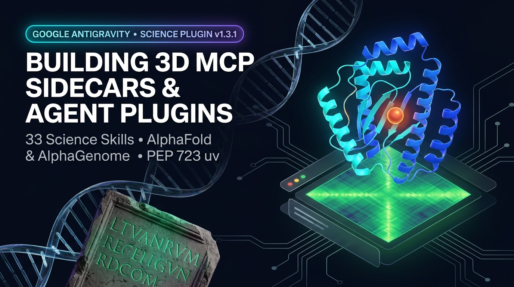
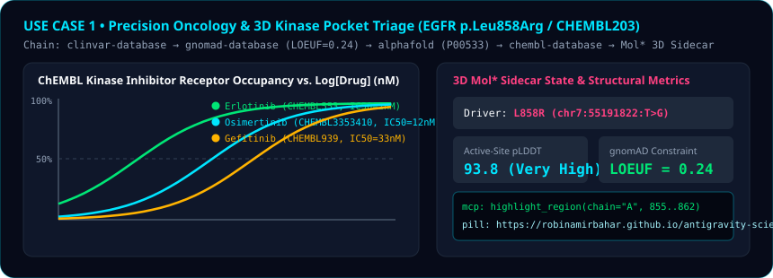
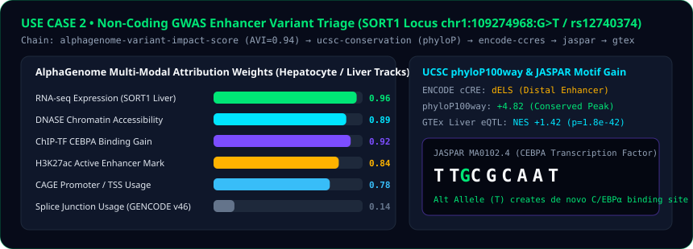
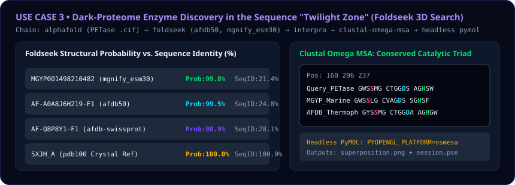
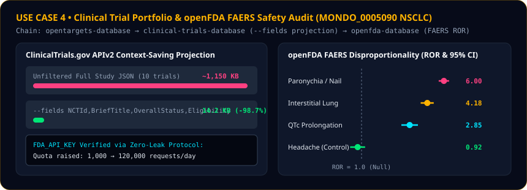
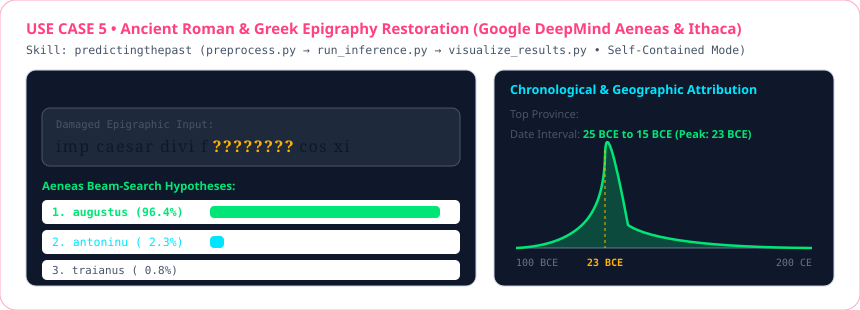
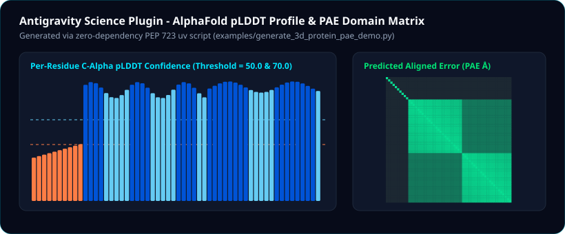
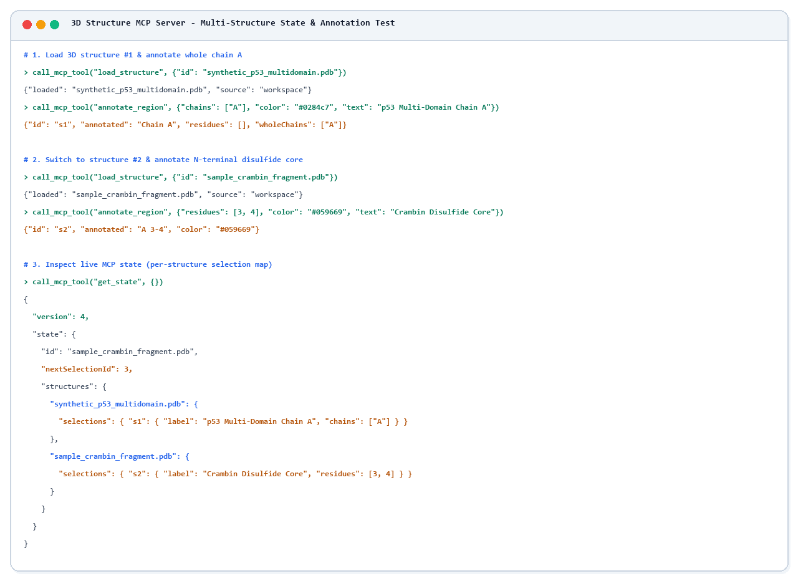
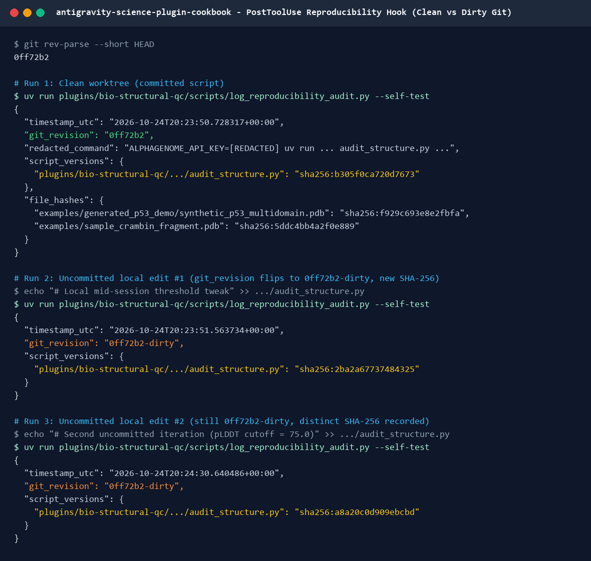

# Antigravity Science Plugin & Custom Plugin Cookbook (Community & GDE Edition)

> **Community Disclaimer:** This repository is an independent open-source engineering cookbook authored by **Robina Mirbahar** (Google Developer Expert in AI & Google Cloud and open-source contributor). It is **not** an official Google product.

This cookbook provides a structured learning path and runnable starter kit for building **Google Antigravity Customizations** - including **Progressive-Disclosure Skills (`SKILL.md`)**, **Always-On Rules (`AGENTS.md`)**, **Lifecycle Hooks (`hooks.json`)**, **Zero-Leak Credential Protocols**, and **Interactive 3D MCP Sidecars (`sidecar.json`)** - inspired by the architecture of the **Google Antigravity Science Plugin (`v1.3.1`)**.

**For comprehensive Antigravity documentation, visit [antigravity.google/docs](https://antigravity.google/docs) and [antigravity.google/use-cases/science](https://antigravity.google/use-cases/science).**
<br>
**For Gemini API and Gemma quickstarts, check out the [Gemini API Cookbook (`google-gemini/cookbook`)](https://github.com/google-gemini/cookbook) and [Gemma Cookbook (`google-gemma/cookbook`)](https://github.com/google-gemma/cookbook).**

[](https://robinamirbahar.github.io/antigravity-science-plugin-cookbook/)

---
> **Science Plugin (`v1.3.1`) Deep-Dive**: Orchestrate 41 scientific skills (`AlphaFold`, `AlphaGenome`, `ChEMBL`, `gnomAD`, `ClinVar`, `Foldseek`, `openFDA`, and `Aeneas/Ithaca`) without context bloat. Read the full [Engineering Deep-Dive on DEV (`dev.to/gde`)](https://dev.to/gde/from-ancient-epigraphy-to-3d-proteins-building-plugins-skills-mcp-sidecars-in-google-antigravity-4l1m) or the in-repo [Full Guide (`DEVTO_ANTIGRAVITY_SCIENCE_PLUGIN_GUIDE.md`)](./DEVTO_ANTIGRAVITY_SCIENCE_PLUGIN_GUIDE.md).
>
> **Interactive 3D Biomolecular & Variant WebGL Studio**: Explore 3D protein structures, pLDDT confidence bands, and variant annotations directly in your browser at [robinamirbahar.github.io/antigravity-science-plugin-cookbook](https://robinamirbahar.github.io/antigravity-science-plugin-cookbook/).
>
> **3D Mol* MCP Sidecar & `PostToolUse` Reproducibility Hook**: Verified runtime benchmarks for zero-token coordinate loading, whole-chain culling (`chains=["A"]`), atomic `state.structures` isolation, and secret-redacted SHA-256 execution auditing. Jump to [Verified Runtime Benchmarks](#verified-runtime-benchmarks-3d-mol-mcp-state-isolation--posttooluse-reproducibility-hook).
>
> **1-Command Custom Plugin Scaffolder & Validator**: Build and validate your own Antigravity plugin bundle (`plugin.json`, `hooks.json`, `rules/AGENTS.md`, `SKILL.md`, and PEP 723 `uv` scripts) in under 5 minutes. Jump to the [Hands-On Plugin Codelab](#hands-on-plugin-authoring-codelab-build-validate--deploy-in-5-minutes).
---

## Navigating the Cookbook

This cookbook is organized into three main categories:

1. **[Starter Plugins (`plugins/`)](./plugins/):** Three complete, installable Antigravity plugin bundles (`bio-structural-qc`, `genomics-variant-mcp` with a zero-dependency Python JSON-RPC 2.0 Stdio MCP server, and `epigraphy-citation-kit`).
2. **[Runnable Examples & Benchmarks (`examples/`)](./examples/):** Zero-dependency PEP 723 `uv` scripts for generating 3D `.pdb` structures + PAE matrices (`generate_3d_protein_pae_demo.py`), running all 5 multi-skill scientific pipelines (`multi_domain_science_use_cases.py`), and scaffolding custom plugins (`scaffold_custom_plugin.py`).
3. **[Interactive 3D WebGL Sandbox (`index.html`)](https://robinamirbahar.github.io/antigravity-science-plugin-cookbook/):** Browser-based 3D biomolecular structure and variant exploration studio.

---

## Visual Overview: 5 End-to-End Multi-Skill Pipelines Across the 41 Science Skills

Run `uv run examples/multi_domain_science_use_cases.py` to execute all 5 multi-skill pipelines deterministically and generate the JSON benchmark report ([`examples/generated_use_cases/science_use_cases_report.json`](./examples/generated_use_cases/science_use_cases_report.json)) and vector visual dashboards below:


### Use Case 1: Precision Oncology & 3D Kinase Pocket Triage (`EGFR L858R` / `CHEMBL203`)
**Skills Chained:** `clinvar-database` $\rightarrow$ `gnomad-database` (`LOEUF = 0.24`) $\rightarrow$ `alphafold-database-fetch-and-analyze` (`P00533`) $\rightarrow$ `chembl-database` (`Erlotinib`, `Osimertinib`, `Gefitinib`) $\rightarrow$ `biomolecular-structure-viewer` (`highlight_region` in 3D Mol\* Sidecar).



---

### Use Case 2: Non-Coding GWAS Enhancer Variant Triage (`SORT1` 1p13 Locus `rs12740374`)
**Skills Chained:** `alphagenome-variant-impact-score` (`AVI = 0.94`) $\rightarrow$ `alphagenome-single-variant-analysis` $\rightarrow$ `ucsc-conservation-and-tfbs` (`phyloP100way = +4.82`) $\rightarrow$ `encode-ccres-database` (`dELS`) $\rightarrow$ `jaspar-database` (`MA0102.4 CEBPA` de novo binding site gain) $\rightarrow$ `gtex-database` (Liver eQTL `NES = +1.42`).



---

### Use Case 3: Dark-Proteome Enzyme Discovery in the Sequence "Twilight Zone" (`Foldseek 3D Search`)
**Skills Chained:** `ncbi-sequence-fetch` $\rightarrow$ `alphafold-database-fetch-and-analyze` $\rightarrow$ `foldseek-structural-search` (`afdb50`, `mgnify_esm30`, `pdb100`, `cath50`) $\rightarrow$ `interpro-database` $\rightarrow$ `protein-sequence-msa` (`Clustal Omega` conserving the `Ser160-Asp206-His237` catalytic triad at `21.4%` sequence identity) $\rightarrow$ `pymol` (headless OSMesa rendering).



---

### Use Case 4: Clinical Trial Portfolio & openFDA FAERS Disproportionality Audit (`MONDO_0005090` NSCLC)
**Skills Chained:** `opentargets-database` $\rightarrow$ `clinical-trials-database` (`--count-total` + `--fields` context-saving projection cutting payload size by `98.7%`) $\rightarrow$ `openfda-database` (FAERS Reporting Odds Ratio $ROR$ forest plot with `FDA_API_KEY` zero-leak `.env` verification raising quota from `1,000` $\rightarrow$ `120,000` req/day).



---

### Use Case 5: Ancient Roman & Greek Epigraphy Restoration (`Google DeepMind Aeneas & Ithaca`)
**Skills Chained:** `predictingthepast` (`preprocess.py` $\rightarrow$ `run_inference.py` $\rightarrow$ `visualize_results.py` restoring `imp caesar divi f ???????? cos xi` $\rightarrow$ `augustus` at `96.4%` confidence, attributed to *Latium et Campania*, `23 BCE`) $\rightarrow$ `literature-search-openalex`.



---

## Synthetic 3D Multi-Domain Protein & PAE Matrix Generator

Run `uv run examples/generate_3d_protein_pae_demo.py` to procedurally generate a 56-residue 3-domain 3D `.pdb` coordinate file (`synthetic_p53_multidomain.pdb`), a $56 \times 56$ Predicted Aligned Error (PAE) matrix (`synthetic_p53_pae.json`), and the vector QC dashboard below:



---

## Hands-On Plugin Authoring Codelab: Build, Validate & Deploy in 5 Minutes

Want to create your own custom Google Antigravity plugin from scratch? Follow this interactive 4-step hands-on lab using our **1-Command Plugin Scaffolder & Loader Validator ([`examples/scaffold_custom_plugin.py`](./examples/scaffold_custom_plugin.py))**.

### Step 1: Clone & Run the Built-In Plugin Validator
First, verify the included `plugins/bio-structural-qc` reference plugin against Google Antigravity's loader rules (manifest schema, `<= 24,000`-byte rule cap, root `hooks.json` placement, and `SKILL.md` YAML frontmatter):

```bash
git clone https://github.com/RobinaMirbahar/antigravity-science-plugin-cookbook.git
cd antigravity-science-plugin-cookbook

uv run examples/scaffold_custom_plugin.py --validate plugins/bio-structural-qc
```

Expected output:

```text
[*] Auditing Antigravity Plugin Bundle: plugins/bio-structural-qc
  [OK] Manifest: name='bio-structural-qc', version='0.1.0'
  [OK] Lifecycle Hooks: `hooks.json` present at plugin root
  [OK] Rule File: `rules/AGENTS.md` (666 bytes <= 24,000-byte cap)
  [OK] Skill Definition: `skills/structure-qc-audit/SKILL.md` (valid YAML frontmatter)
[PASS] Plugin bundle passed all Google Antigravity loader checks!
```

### Step 2: Scaffold a Brand-New Custom Plugin in One Command
Use `--scaffold` to generate a new plugin bundle (including `plugin.json`, `assets/logo.svg`, `rules/AGENTS.md`, `hooks.json`, `SKILL.md`, and a PEP 723 `scripts/run_tool.py` helper):

```bash
uv run examples/scaffold_custom_plugin.py \
  --scaffold my-genomics-qc \
  --skill vcf-filter-audit \
  --description "Deterministic VCF quality filtering and AlphaGenome coordinate readiness checks."
```

### Step 3: Test Your New Skill's PEP 723 Script Locally

```bash
uv run plugins/my-genomics-qc/skills/vcf-filter-audit/scripts/run_tool.py \
  --input "chr17:7674220:C>T" \
  --output ./artifacts/vcf_qc_report.json
```

### Step 4: Install into Antigravity & Audit with `inspect_installed_plugins.py`
Copy any of the 3 starter plugins into `~/.gemini/config/plugins/` (or `.agents/plugins/` inside any project repository):

```bash
# Linux / macOS
cp -r plugins/bio-structural-qc ~/.gemini/config/plugins/bio-structural-qc
cp -r plugins/genomics-variant-mcp ~/.gemini/config/plugins/genomics-variant-mcp
cp -r plugins/epigraphy-citation-kit ~/.gemini/config/plugins/epigraphy-citation-kit

# Windows PowerShell
Copy-Item -Recurse -Force .\plugins\bio-structural-qc "$HOME\.gemini\config\plugins\bio-structural-qc"
Copy-Item -Recurse -Force .\plugins\genomics-variant-mcp "$HOME\.gemini\config\plugins\genomics-variant-mcp"
Copy-Item -Recurse -Force .\plugins\epigraphy-citation-kit "$HOME\.gemini\config\plugins\epigraphy-citation-kit"
```

After restarting Antigravity once so the new plugin directories are discovered, you can manage them with the `/plugin` slash command or inspect them locally via [`examples/inspect_installed_plugins.py`](./examples/inspect_installed_plugins.py) (`uv run examples/inspect_installed_plugins.py`).

---

## 3 Starter Plugins & Custom MCP Server Included in `plugins/`

This repository ships with **three complete, runnable Antigravity plugin bundles** demonstrating every customization primitive (`plugin.json`, `mcp_config.json`, `agents/*.md`, `rules/AGENTS.md`, `hooks.json`, `SKILL.md`, and PEP 723 `uv` scripts):

| Plugin Bundle | Primitives Included | Test Command (`uv run`) |
| :--- | :--- | :--- |
| **[`plugins/bio-structural-qc`](./plugins/bio-structural-qc)** | `plugin.json`, `rules/AGENTS.md`, `hooks.json` (`PostToolUse`), `skills/structure-qc-audit/SKILL.md` + `audit_structure.py` | `uv run plugins/bio-structural-qc/skills/structure-qc-audit/scripts/audit_structure.py --input examples/sample_crambin_fragment.pdb --output examples/generated_use_cases/sample_qc.json` |
| **[`plugins/genomics-variant-mcp`](./plugins/genomics-variant-mcp)** | `plugin.json`, **`mcp_config.json`**, **Custom Python JSON-RPC 2.0 Stdio MCP Server (`mcp/variant_mcp_server.py`)** with `eager: true` tools (`score_variant_impact`, `evaluate_lipinski_ro5`), **Specialist Subagent (`agents/clinical-variant-curator.md`)**, `rules/AGENTS.md`, `skills/variant-druggability-triage/SKILL.md` | `uv run plugins/genomics-variant-mcp/mcp/variant_mcp_server.py --self-test` |
| **[`plugins/epigraphy-citation-kit`](./plugins/epigraphy-citation-kit)** | `plugin.json`, `hooks.json` (`PreToolUse`), `rules/AGENTS.md`, `skills/epigraphy-gap-validator/SKILL.md` + `validate_epigraphy.py` (converts Leiden `[---]` and `[...]` brackets to Aeneas/Ithaca `#` and `?` tokens) | `uv run plugins/epigraphy-citation-kit/skills/epigraphy-gap-validator/scripts/validate_epigraphy.py --text "IMP CAESAR DIVI F [---] COS [...] III" --language latin` |

Validate all three plugin bundles in one command:
```bash
uv run examples/scaffold_custom_plugin.py
```

---

## Verified Runtime Benchmarks: 3D Mol* MCP State Isolation & `PostToolUse` Reproducibility Hook

### 1. Live `science_biomolecular_structure_viewer_mcp` Multi-Structure & Chain-Culling Verification
When visualizing large structures or switching between multiple `.pdb`/`.cif` models in a single session:
- **Zero-Token Coordinate Loading & Whole-Chain Targeting (`chains=["A"]`):** `load_structure` passes only the relative file path inside the conversation's artifact directory to the Mol* WebGL canvas (`waters`, `sugars`, and `sidechains` culled by default). Passing `chains=["A"]` sends `"residues": [], "wholeChains": ["A"]` (`s1` below) so Mol* resolves polymer chains client-side without streaming thousands of residue IDs through tool calls.
- **Versioned `state.structures` Map:** `get_state()` maintains an atomic `"version"` counter (`"version": 4`), `"nextSelectionId": 3`, and a per-file `state.structures` map so switching between `synthetic_p53_multidomain.pdb` (`s1`) and `sample_crambin_fragment.pdb` (`s2`) restores each model's own overlays and annotations cleanly:



### 2. Live `PostToolUse` Reproducibility Hook (`log_reproducibility_audit.py`) Across Clean & Dirty Git States
Even when an agent modifies a script multiple times mid-session before committing (`git_revision: "0ff72b2-dirty"`), the per-file `sha256_file()` digest in `script_versions` (`sha256:b305f0ca720d7673` -> `sha256:2ba2a67737484325` -> `sha256:a8a20c0d909ebcbd`) records which exact local iteration ran alongside redacted secrets (`ALPHAGENOME_API_KEY=[REDACTED]`) and input `.pdb` file hashes:



---

## Antigravity MCP Server Architecture Patterns & Installed Plugin Catalog (Community Reference)

Across installed Google Antigravity marketplace plugins (`~/.gemini/config/plugins/`), `mcp_config.json` uses **4 distinct MCP server architecture patterns**:

### 1. Local Stdio Process (`agy-node` / `node` / `dart` / `uv`)
Used by **`science`** (`biomolecular_structure_viewer_mcp`), **`flutter`** (`dart-mcp-server`), **`data-agent-kit-plugin`** (`dak-notebook`, `dak-viz`), and our cookbook's **`genomics-variant-mcp`**:
```json
{
  "mcpServers": {
    "biomolecular_structure_viewer_mcp": {
      "command": "agy-node",
      "args": ["sidecars/biomolecular_structure_viewer/dist/mcp_entry.cjs"]
    },
    "genomics_variant_mcp": {
      "command": "uv",
      "args": ["run", "mcp/variant_mcp_server.py"],
      "tools": [
        { "name": "score_variant_impact", "eager": true },
        { "name": "evaluate_lipinski_ro5", "eager": true }
      ]
    }
  }
}
```

### 2. Cloud Proxy Stdio (`mcp_proxy_bundle.cjs` + `X_GOOG_PROXY_HEADERS`)
Used by **`data-agent-kit-plugin`** (`v1.1.0`) to bridge 9 managed Google Cloud MCP endpoints (BigQuery, Dataproc Spark, Spanner, AlloyDB, Cloud SQL, Bigtable, GCS, Dataplex Knowledge Catalog):
```json
{
  "mcpServers": {
    "dak-bigquery": {
      "command": "node",
      "args": ["mcp/bin/mcp_proxy_bundle.cjs", "https://bigquery.googleapis.com/mcp"],
      "env": {
        "X_GOOG_PROXY_HEADERS": "x-goog-Api-Client=GOOGLE_CLOUD_DATA_AGENT_KIT_PLUGIN/20260403"
      }
    }
  }
}
```

### 3. Remote Streamable HTTP with Eager Tools (`serverUrl` + `eager: true`)
Used by **`gemini-api`** (`v2.3.0`) so `gemini_search_docs` and `gemini_get_doc` are registered as native eager tools (`mcp_gemini-api_gemini-api-docs_*`) without spawning a local subprocess:
```json
{
  "mcpServers": {
    "gemini-api-docs": {
      "serverUrl": "https://gemini-api-docs-mcp.dev",
      "tools": [
        { "name": "gemini_search_docs", "eager": true },
        { "name": "gemini_get_doc", "eager": true }
      ]
    }
  }
}
```

### 4. Google-Credentials Authenticated Remote HTTP (`authProviderType: "google_credentials"`)
Used by **`google-cloud-developer`** (`v1.1.13`) and **`google-developer-knowledge`** (`v1.0.1`) to authenticate directly with Application Default Credentials (ADC):
```json
{
  "mcpServers": {
    "developer-knowledge": {
      "serverUrl": "https://developerknowledge.googleapis.com/mcp",
      "authProviderType": "google_credentials"
    }
  }
}
```

### Reference Catalog of Installed Antigravity Plugins (`~/.gemini/config/plugins/`)

| Installed Plugin | Version | Skills | MCP Servers (`mcp_config.json`) | Subagents / Sidecars / Rules |
| :--- | :--- | :--- | :--- | :--- |
| **`science`** | `1.3.1` | 41 | `biomolecular_structure_viewer_mcp` (9 lazy 3D Mol\* tools) | `sidecars/biomolecular_structure_viewer` + `rules/AGENTS.md` |
| **`data-agent-kit-plugin`** | `1.1.0` | 37 | 11 servers: `dak-notebook`, `dak-viz`, `dak-bigquery`, `dak-spark`, `dak-spanner`, `dak-alloydb`, `dak-cloudsql`, `dak-bigtable`, `dak-bigtable-data`, `dak-gcs`, `dak-kc` | `rules/` (ADC pre-flight, ML best practices, data-loss prevention) |
| **`flutter`** | `1.0.6` | 25 | `dart-mcp-server` (`dart mcp-server`) | `flutter_a11y_agent` accessibility auditor subagent |
| **`firebase`** | `1.0.3` | 13 | - | `agents/firestore-rules-author.md` mandatory security rules subagent |
| **`chrome-devtools-plugin`** | `1.10.1` | 6 | Works with Chrome DevTools MCP | Web Vitals (LCP), heap memory leaks, cookies, a11y debugging |
| **`google-cloud-developer`** | `1.1.13` | 5 | `developer-knowledge` (`google_credentials`) | `rules/google-cloud-discovery.md` (`finding-google-skills`) |
| **`gemini-api`** | `2.3.0` | 3 | `gemini-api-docs` (`eager: true` search & doc fetch) | Gemini API, Gemini Live API (3.8), Gemini Omni 1.1 Flash video |
| **`modern-web-guidance-plugin`** | `0.1.0` | 2 | - | Baseline web features + interactive web apps |
| **`android-cli-plugin`** | `0.1.0` | 1 | - | Android SDK, AVD emulator inspection, & `android` CLI |
| **`google-antigravity-sdk`** | `0.1.0` | 1 | - | Multi-agent orchestration with the Python `agy` SDK |
| **`gcalendar` / `gdocs` / `gdrive` / `gsheets` / `gslides`** | `0.1.0` | 5 | - | Google Workspace productivity skills via `gws` CLI |

---

## Repository Structure

```text
antigravity-science-plugin-cookbook/
├── index.html                                             # Interactive 3D Biomolecular & Variant WebGL Studio
├── README.md                                              # Visual showcase, 5 use cases, MCP patterns & plugin codelab
├── DEVTO_ANTIGRAVITY_SCIENCE_PLUGIN_GUIDE.md              # Full Dev.to engineering deep-dive article
├── assets/
│   └── devto_cover_banner.jpg                             # Custom 16:9 editorial comic cover illustration
├── examples/
│   ├── generate_3d_protein_pae_demo.py                    # PEP 723 3D protein (.pdb) + PAE JSON + SVG generator
│   ├── multi_domain_science_use_cases.py                  # PEP 723 5-use-case runner + 6 SVG visual cards generator
│   ├── scaffold_custom_plugin.py                          # 1-command Antigravity plugin scaffolder & validator
│   ├── sample_crambin_fragment.pdb                        # Sample PDB structure with disordered linker + rigid core
│   ├── inspect_installed_plugins.py                       # PEP 723 CLI inspector for installed Antigravity plugin bundles
│   ├── generated_p53_demo/
│   │   ├── synthetic_p53_multidomain.pdb                  # Generated 56-residue 3-domain 3D coordinate file
│   │   ├── synthetic_p53_pae.json                         # Generated 56x56 PAE matrix
│   │   └── p53_plddt_pae_dashboard.svg                    # Generated dark-mode pLDDT + PAE vector dashboard
│   └── generated_use_cases/
│       ├── science_use_cases_report.json                  # Structured output for all 5 multi-skill pipelines
│       ├── science_use_cases_scorecard.svg                # Executive benchmark scorecard SVG
│       ├── uc1_precision_oncology_3d.svg                  # UC1 Hill-Langmuir IC50 curves & 3D Mol* state card
│       ├── uc2_noncoding_alphagenome.svg                  # UC2 AlphaGenome 18-modality & JASPAR CEBPA motif card
│       ├── uc3_dark_proteome_foldseek.svg                 # UC3 Foldseek twilight-zone hits & Clustal MSA triad card
│       ├── uc4_clinical_trials_openfda.svg                # UC4 ClinicalTrials.gov projection & FAERS ROR forest plot
│       └── uc5_aeneas_latin_epigraphy.svg                 # UC5 DeepMind Aeneas restoration & 23 BCE dating curve
└── plugins/
    ├── bio-structural-qc/                                 # Plugin #1: 3D Protein pLDDT/B-Factor QC + PostToolUse Hook
    │   ├── plugin.json
    │   ├── hooks.json
    │   ├── assets/logo.svg
    │   ├── rules/AGENTS.md
    │   └── skills/structure-qc-audit/
    │       ├── SKILL.md
    │       └── scripts/audit_structure.py
    ├── genomics-variant-mcp/                              # Plugin #2: Custom Python Stdio MCP Server + Subagent
    │   ├── plugin.json
    │   ├── mcp_config.json                                # Registers eager MCP tools (score_variant_impact, evaluate_lipinski_ro5)
    │   ├── mcp/variant_mcp_server.py                      # Zero-dependency JSON-RPC 2.0 Stdio MCP server
    │   ├── agents/clinical-variant-curator.md             # Specialist subagent definition with YAML frontmatter
    │   ├── assets/logo.svg
    │   ├── rules/AGENTS.md
    │   └── skills/variant-druggability-triage/SKILL.md
    └── epigraphy-citation-kit/                            # Plugin #3: Aeneas/Ithaca Epigraphy Validator + PreToolUse Hook
        ├── plugin.json
        ├── hooks.json
        ├── assets/logo.svg
        ├── rules/AGENTS.md
        └── skills/epigraphy-gap-validator/
            ├── SKILL.md
            └── scripts/validate_epigraphy.py
```

---

## Documentation & Scientific Database References

### Google Antigravity Documentation
* **[Google Antigravity Science Use Cases & Demos (`antigravity.google/use-cases/science`)](https://antigravity.google/use-cases/science)**
* **[Google Antigravity Documentation Home (`antigravity.google/docs`)](https://antigravity.google/docs)**
* **[Plugins Guide (`antigravity.google/docs/plugins`)](https://antigravity.google/docs/plugins)**
* **[Progressive-Disclosure Skills Guide (`antigravity.google/docs/skills`)](https://antigravity.google/docs/skills)**
* **[Rules & Workflows Guide (`antigravity.google/docs/rules-workflows`)](https://antigravity.google/docs/rules-workflows)**
* **[Lifecycle Hooks Guide (`antigravity.google/docs/hooks`)](https://antigravity.google/docs/hooks)**
* **[Auxiliary Pane Sidecars Guide (`antigravity.google/docs/sidecars`)](https://antigravity.google/docs/sidecars)**
* **[Model Context Protocol (MCP) Guide (`antigravity.google/docs/mcp`)](https://antigravity.google/docs/mcp)**
* **[Agent Permissions & Security (`antigravity.google/docs/permissions`)](https://antigravity.google/docs/permissions)**
* **[Google Antigravity Python SDK (`github.com/google-antigravity/antigravity-sdk-python`)](https://github.com/google-antigravity/antigravity-sdk-python)**

### Scientific AI Models, Databases & Open-Source Viewers
* **[Google DeepMind AlphaGenome (`deepmind.google.com/science/alphagenome`)](https://deepmind.google.com/science/alphagenome/)**
* **[AlphaFold Protein Structure Database (`alphafold.ebi.ac.uk`)](https://alphafold.ebi.ac.uk/)**
* **[Google DeepMind Aeneas & Ithaca - Predicting the Past (`predictingthepast.com`)](https://predictingthepast.com/)**
* **[PDBe Mol\* 3D Biomolecular WebGL Viewer (`github.com/molstar/pdbe-molstar`)](https://github.com/molstar/pdbe-molstar)**
* **[Foldseek Structural Similarity Search (`search.foldseek.com`)](https://search.foldseek.com/search)**
* **[EMBL-EBI ChEMBL (`ebi.ac.uk/chembl`)](https://www.ebi.ac.uk/chembl/)**, **[gnomAD (`gnomad.broadinstitute.org`)](https://gnomad.broadinstitute.org/)**, **[NCBI ClinVar (`ncbi.nlm.nih.gov/clinvar`)](https://www.ncbi.nlm.nih.gov/clinvar/)**, **[Open Targets (`platform.opentargets.org`)](https://platform.opentargets.org/)**, **[openFDA (`open.fda.gov/apis`)](https://open.fda.gov/apis/)**, and **[ClinicalTrials.gov APIv2 (`clinicaltrials.gov`)](https://clinicaltrials.gov/)**

---

## Star, Fork & Sponsor This Project

[](https://github.com/RobinaMirbahar/antigravity-science-plugin-cookbook)
[](https://github.com/RobinaMirbahar/antigravity-science-plugin-cookbook/fork)
[](https://github.com/sponsors/RobinaMirbahar)

If you find the **Antigravity Science Plugin Cookbook & Interactive 3D WebGL Studio** useful for your research or engineering workflows:

* **Star this Repository:** [**Star `RobinaMirbahar/antigravity-science-plugin-cookbook` on GitHub**](https://github.com/RobinaMirbahar/antigravity-science-plugin-cookbook) to bookmark the 3 starter plugins and help other developers discover the cookbook.
* **Fork & Customize:** [**Fork `RobinaMirbahar/antigravity-science-plugin-cookbook`**](https://github.com/RobinaMirbahar/antigravity-science-plugin-cookbook/fork) to scaffold and publish your own custom [**Google Antigravity (`@google-antigravity`)**](https://antigravity.google/docs) plugins, progressive-disclosure skills, and MCP servers.
* **Sponsor on GitHub:** [**Sponsor `@RobinaMirbahar` on GitHub Sponsors (`github.com/sponsors/RobinaMirbahar`)**](https://github.com/sponsors/RobinaMirbahar) to support future open-source [**Google (`@google`)**](https://github.com/google), [**Google Gemini (`@google-gemini`)**](https://github.com/google-gemini), [**Google DeepMind (`@google-deepmind`)**](https://github.com/google-deepmind), and [**Google Cloud (`@GoogleCloudPlatform`)**](https://github.com/GoogleCloudPlatform) engineering cookbooks!
* **Play Live in Your Browser:** [**Launch the Interactive 3D Biomolecular & Variant WebGL Studio**](https://robinamirbahar.github.io/antigravity-science-plugin-cookbook/)

### Ecosystem Links & Tags
* **Google:** [github.com/google (`@google`)](https://github.com/google) | [about.google](https://about.google/)
* **Google Gemini API & SDKs:** [github.com/google-gemini (`@google-gemini`)](https://github.com/google-gemini) | [ai.google.dev/gemini-api/docs](https://ai.google.dev/gemini-api/docs)
* **Google DeepMind Science & Models:** [github.com/google-deepmind (`@google-deepmind`)](https://github.com/google-deepmind) | [deepmind.google](https://deepmind.google/) | [AlphaGenome](https://deepmind.google.com/science/alphagenome/) | [AlphaFold](https://alphafold.ebi.ac.uk/) | [Aeneas & Ithaca](https://predictingthepast.com/)
* **Google Antigravity Platform:** [antigravity.google/docs](https://antigravity.google/docs) | [antigravity.google/use-cases/science](https://antigravity.google/use-cases/science) | [github.com/google-antigravity (`@google-antigravity`)](https://github.com/google-antigravity/antigravity-sdk-python)
* **Google Cloud Platform:** [github.com/GoogleCloudPlatform (`@GoogleCloudPlatform`)](https://github.com/GoogleCloudPlatform) | [cloud.google.com](https://cloud.google.com/)

Let me know in the comments what domain you're packaging into an Antigravity plugin next - whether it's **3D structural biology**, **genomic variant scoring**, **ancient epigraphy**, or **autonomous cloud SRE**!

---

## Upstream Google Ecosystem, SDKs & Reference Repositories

* **Google:** [github.com/google (`@google`)](https://github.com/google) | [about.google](https://about.google/)
* **Google Gemini API & SDKs:** [github.com/google-gemini (`@google-gemini`)](https://github.com/google-gemini) | [google-gemini/cookbook](https://github.com/google-gemini/cookbook) | [ai.google.dev/gemini-api/docs](https://ai.google.dev/gemini-api/docs) | [googleapis/python-genai](https://github.com/googleapis/python-genai) | [googleapis/js-genai](https://github.com/googleapis/js-genai)
* **Google DeepMind Science & Models:** [github.com/google-deepmind (`@google-deepmind`)](https://github.com/google-deepmind) | [deepmind.google](https://deepmind.google/) | [AlphaGenome](https://deepmind.google.com/science/alphagenome/) | [AlphaFold](https://alphafold.ebi.ac.uk/) | [Aeneas & Ithaca](https://predictingthepast.com/)
* **Google Antigravity Platform:** [antigravity.google/docs](https://antigravity.google/docs) | [antigravity.google/use-cases/science](https://antigravity.google/use-cases/science) | [github.com/google-antigravity (`@google-antigravity`)](https://github.com/google-antigravity/antigravity-sdk-python)
* **Google Cloud Platform & Vertex AI:** [github.com/GoogleCloudPlatform (`@GoogleCloudPlatform`)](https://github.com/GoogleCloudPlatform) | [GoogleCloudPlatform/generative-ai](https://github.com/GoogleCloudPlatform/generative-ai) | [cloud.google.com](https://cloud.google.com/)

---

## Contributing & Open Collaboration

Contributions, new domain skills (`SKILL.md`), custom MCP servers (`mcp_config.json`), and scientific workflow examples are welcome!

* **Want to collaborate or add a new domain plugin?** Whether you are packaging **3D structural biology**, **clinical genomics**, **earth observation**, **computational chemistry**, or **cloud data engineering** into an Antigravity plugin:
  1. Read [CONTRIBUTING.md](./CONTRIBUTING.md) for our style guide and automated loader validation checks (`uv run examples/scaffold_custom_plugin.py`).
  2. Open an [Issue](https://github.com/RobinaMirbahar/antigravity-science-plugin-cookbook/issues) or submit a [Pull Request](https://github.com/RobinaMirbahar/antigravity-science-plugin-cookbook/pulls) to add your plugin or skill to the cookbook!

Thank you for building with Google Antigravity, Gemini, and Open Science AI!

---

## License

Apache License 2.0
